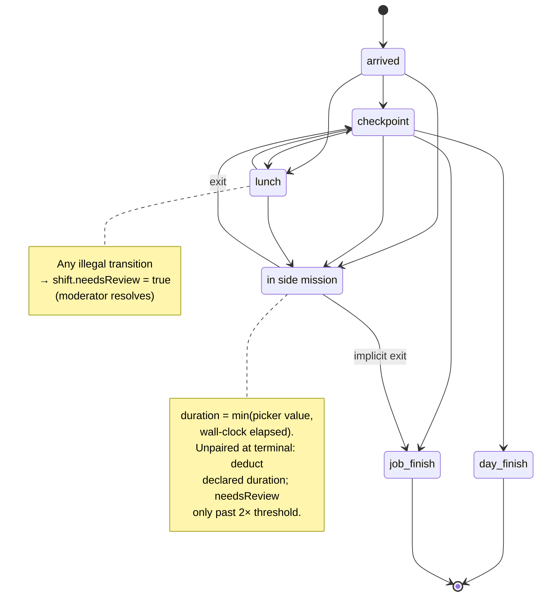

# J-Pay v1.1 → v1.2 Remediation Implementation Plan

> **For Hermes/Claude:** REQUIRED SUB-SKILL: Use superpowers:executing-plans to implement this plan task-by-task.

**Goal:** Close the four blocking findings (B1–B3 + second-pass Background Sync escalation) and the seven medium findings from `REVIEW-v1.1.md`, producing a TRD v1.2 that is internally consistent and verified against live platform limits before any code exists.

**Architecture:** Documentation-first remediation — this plan edits the TRD (`j-pay.md` source of truth) and its schema block only. No application code, no repo scaffolding, no Convex deployment. The corrected TRD becomes the contract for a future greenfield build in `TeacherEvan/J-pay-webb_logger`.

**Tech Stack:** Markdown TRD · Convex schema (TypeScript, in-document) · Convex Auth (replaces Clerk per owner decision 2026-08-23) · Next.js 15/16 decision record · Serwist PWA.

**Effort:** ~3 days | **Surfaces touched:** 1 doc (+1 new ADR appendix) | **New tables:** 0 code / 2 schema amendments in-doc (`pushSubscriptions` fix, optional `siteHistory`) | **Feature flag:** n/a (docs only)

---

## Guardrails (binding for every task in this plan)

These rules apply to the executing agent and any subagent. Violating a guardrail = task not complete, regardless of script exit code.

### G1 — Scope containment
- Work happens ONLY inside `/home/ewaldt/Documents/VS/Other/J-pay/`. No sibling directories, no scaffolding of `TeacherEvan/J-pay-webb_logger`, no `npm create`, no `git clone` — this is a docs-only remediation.
- Never edit files outside this folder; never enumerate or touch other repos.

### G2 — Schema is copy-paste truth
- Every TypeScript block edited into §6 must be **syntactically valid Convex schema code**. After each schema edit, extract the fenced ```ts block and parse it with a TypeScript parser (or `npx tsc --noEmit` in a scratch dir with `convex/server` stubbed). A broken fence that "looks right" is a failed task.

### G3 — Verified facts only
- Any limit number, package version, or API claim added to the TRD must carry its source + check date inline (e.g. "verified 2026-08-23, docs.convex.dev/..."). No memory-written numbers. If verification isn't possible in-session, mark `⚠ UNVERIFIED` rather than asserting.

### G4 — Mermaid integrity gate
- Every mermaid block written or edited by this plan must pass mechanical validation before commit: extract all ```mermaid fences and validate structure with the diagram-gate script (Task 8). A diagram that renders blank/broken in GitHub is a failed task.

### G5 — Commit hygiene
- One scoped conventional commit per task (`docs(j-pay): ...`). No `git push` without explicit user instruction. The repo is initialized fresh in this folder during Task 1 — `.gitignore` (Task 9) lands BEFORE the first commit so nothing junk is ever tracked.

### G6 — Secrets & privacy
- No deploy keys, VAPID private keys, Clerk keys, or employee data anywhere in these docs. Placeholder env names only (`CONVEX_DEPLOY_KEY=...` never filled). The TRD describes a real payroll/location system — treat every example payload as if it were PII.

### G7 — Plan-vs-doc agreement
- If execution reveals the plan itself is wrong (a finding was mis-stated), STOP and amend THIS plan file first (bump revision), then continue. Never let the TRD silently diverge from the plan executing it.

### Execution Revisions (2026-08-23 — G7 amendments made during execution)

- **Rev A (Task 1):** The D4 gate in `scripts/check_consistency.py` is document-wide (`\bClerk\b` anywhere fails), but Task 1's original edit list could not clear Clerk residue in §5.2, §5.3, §7 (device-binding bullet + AuthN/AuthZ), and §10.3. The global Clerk→Convex Auth sweep — including Task 7 Step 3's §5.3 issuance text — is pulled forward into Task 1 so its stated Step 5 gate ("D4/B1 failure lines gone") is achievable. Task 7's D4/M5 checks become residual verification.
- **Rev B (Task 2):** Task 2 Step 2 greps for `side_mission` inside the §10.5 diagram body, but the Step 3 diagram aliased the substate as `sm` (no underscore) — the test could never clear. Diagram amended: `state "in side mission" as side_mission`.
- **Rev C (Task 5):** Task 5's M2 test greps `1MB transaction limit`, which also occurs in §8 item 4 (outside Task 5's original file list). Task 5 extended to rewrite §8 item 4 to the 16 MiB write-budget wording.
- **Rev D (Task 6):** The M3 gate matches only literal `zero out lat/lng` or `anonymize (zero`, but Step 3's replacement prose said "lat/lng zeroed" / "anonymized, not deleted" — neither phrase, so the test could never clear on the snippet alone. §9 wording amended to include `zero out lat/lng` explicitly.

---

## Pre-Flight Decisions (owner: Ewaldt — answer before Task 1)

| # | Decision | Options | Default if unanswered |
|---|---|---|---|
| D1 | Multi-tenant or single-org? (TRD Open Q1) | single-org v1 / multi-tenant now | **single-org**, note tenant-split as v2 migration |
| D2 | Next.js 15 or 16? (second-pass correction) | pin 15 / upgrade to 16.3.x | **16** (Serwist peerDep `>=14` allows it; App Router mature, Turbopack default) |
| D3 | Diagram tool for moderator UI (Open Q4) | canvas freehand / mermaid render-only | mermaid render-only (matches §5.2 wording) |
| D4 | ~~Clerk~~ → **Convex Auth** — RESOLVED by owner 2026-08-23: remove Clerk entirely, use Convex Auth (password provider) | — | resolved |

---

## Milestone Timeline

### Milestone 1: Blocking Fixes — TRD Consistency (Day 1)
Resolve B1 (route-handler vs reactive contradiction), B2 (state machine completion), B3 (skew index honesty), B4 (Background Sync re-architecture). Contract-level changes; nothing else lands until these are written.

### Milestone 2: Medium Fixes — Schema & Ops Truth (Day 2)
M1 previous-fix lookup spec · M2 limit-wording correction (verified live numbers) · M3 retention/anonymization policy · M4 native Convex cron switch · M5 HMAC secret single-surface · M6 site audit fields · M7 push sender named.

### Milestone 3: Verified-Limits Appendix & Version Bump (Day 3)
Replace memory-based limit claims with the live-verified table; bump to v1.2 with revision log; final internal-consistency pass (every § cross-reference resolves).

---

## Data Flow

### Corrected Check-in Write Path (post-B1/B4)

```
Employee PWA                     Convex Backend
  │                                  │
  ├─ GPS fix (≤50m acc.)             │
  ├─ build payload + idempotencyKey  │
  │                                  │
  ├─ ONLINE: createLog mutation ────────► verify Clerk JWT (ctx.auth)
  │  via ConvexReactClient              │  verify HMAC device token
  │  (DIRECT — not via Vercel RH)       │  haversine vs assigned sites
  │                                  │  clockSkewMs stored at write
  │◄─── ack (_creationTime truth) ◄──────┤  impossible-travel vs prev fix*
  │                                  │  insert log
  │                                  │
  ├─ OFFLINE: write IndexedDB outbox │
  │                                  │
  ├─ RECONNECT (foreground/online ───────► replay outbox in order
  │  event — PRIMARY path; SW BG      │  (clientReportedTime preserved;
  │  sync = Chrome-only bonus)         │  skew flags naturally)
```
\* prev fix = latest by skew-corrected clientReportedTime, queried `by_user_time` desc + take-max (M1).

### Realtime Audit Fan-Out (post-B1)

```
Convex DB ─ ─ ─ reactive query ─ ─ ─ ► Moderator desktop (useQuery, live rows)
    │
    └─ ─ ─ cronJobs() daily purge ─ ─ ► raw-coord anonymizer (M4/M3)
```

## Mockups

Not applicable to this milestone set — all three milestones are documentation/schema-contract work. Employee and Moderator UI mockups belong to the future build-plan derived from TRD v1.2.

## Risk Table

| Risk | Likelihood | Impact | Mitigation |
|------|-----------|--------|------------|
| Owner decisions D1–D3 stall Milestone 1 | Medium | High | Defaults pre-agreed above; plan proceeds on defaults, decisions logged as ADR-001 |
| Schema edits in doc drift from future real `convex/schema.ts` | High | Medium | §1.1 conflict rule already says schema wins; add "copy-paste the §6 block verbatim" instruction to future build plan |
| Background Sync rewrite confuses implementers used to SW-only patterns | Medium | High | New §8 gets explicit platform-support table (Chrome ✅ / Safari ❌ ever / Firefox ❌) so the primary-path choice is self-evident |
| Limit numbers rot again after Vercel/Convex updates | Medium | Low | Verified-limits appendix carries a "checked 2026-08-23" stamp + re-check trigger ("before implementation start") |

---

### Task 1: Resolve B1 + D4 — Rewrite §2 (Deployment Row, Clerk→Convex Auth) & Add Architecture Note

**Files:**
- Modify: `j-pay.md` §2 Stack table (Auth row: Clerk → Convex Auth; Deployment row rewrite)
- Modify: `j-pay.md` §7 Security bullet 1 (add client-direct clarification, swap Clerk JWT → Convex Auth session)
- Modify: `j-pay.md` §10.1 system diagram (CL[Clerk Auth] node → Convex Auth inside backend subgraph)
- Create: `docs/adr/ADR-001-client-direct-convex-auth.md`

**Step 0: Land `.gitignore` FIRST (guardrail G5)** — execute Task 9 Step 3 before any commit in this task.

**Step 1: Write the failing test (consistency check script)**

Create `/home/ewaldt/Documents/VS/Other/J-pay/scripts/check_consistency.py`:

```python
#!/usr/bin/env python3
"""Mechanical consistency gate for j-pay.md. Fails while contradictions exist."""
import re, sys

doc = open("/home/ewaldt/Documents/VS/Other/J-pay/j-pay.md", encoding="utf-8").read()
failures = []

# D4: Clerk must be fully removed
if re.search(r"\bClerk\b", doc):
    failures.append("D4: Clerk still referenced — replace with Convex Auth")

# B1: no claim that ALL convex access flows through route handlers
if re.search(r"All Convex access flows through", doc):
    failures.append("B1: 'All Convex access flows through Next.js route handlers' still present")

# B1: reactive queries must not be described as proxied
if re.search(r"reactive quer.*through (Next|route)", doc, re.I):
    failures.append("B1: reactive queries still described as routed through Next.js")

# B3: 'via that index' skew-filter claim must match an actual index name in schema
if "clockSkewMs" in doc:
    if "by_user_skew" not in doc and re.search(r"filter.*via that index", doc):
        failures.append("B3: skew filter claims index use but by_user_skew absent")

# B4: Background Sync must not be sole replay mechanism
if re.search(r"replay.*Serwist Background Sync when connectivity returns(?!\s*\()", doc) \
   and "foreground reconciliation" not in doc:
    failures.append("B4: offline replay still names Background Sync without foreground-primary language")

# M4: purge must reference native cron or justified Vercel Cron
if "Vercel Cron" in doc and "convex/crons.ts" not in doc:
    failures.append("M4: Vercel Cron referenced without native crons.ts alternative noted")

# M7: push sender must be named
if "web-push" not in doc:
    failures.append("M7: no push sender named (expect web-push via Convex Action)")

print("\n".join(failures) if failures else "ALL CONSISTENCY CHECKS PASS")
sys.exit(1 if failures else 0)
```

**Step 2: Run test to verify it fails**

Run: `python3 scripts/check_consistency.py`
Expected: FAIL listing D4 (Clerk), B1, B4, M4, M7 (current TRD state).

**Step 3: Edit §2 Stack table**

Replace the **Auth row** with:

> | Auth | **Convex Auth** (`@convex-dev/auth`, registry-verified v0.0.95 2026-08-11) with password provider; sessions via `ctx.auth`. Roles (`moderator` \| `employee`) stored on the `users` row and enforced server-side. Moderator provisioning = invite-only internal mutation (no self-signup route shipped). |

Replace the **Deployment row** with:

> Vercel (Edge network). Client applications connect **directly to Convex** via `ConvexReactClient` using the public `NEXT_PUBLIC_CONVEX_URL`, authenticated with Convex Auth sessions. Vercel Route Handlers exist only for secret-free server conveniences: CSV export assembly and edge rate-limiting (device-token issuance moves INTO Convex per Task 7/M5). Data isolation comes from row-scoped authz inside every Convex function (§7 R4), never from URL concealment.

**Step 4: Write ADR-001**

Create `docs/adr/ADR-001-client-direct-convex-auth.md` recording: context (B1 finding + owner decision D4 removing Clerk), decision (client-direct with Convex Auth password provider), consequences (one fewer vendor + no JWT bridging config; auth lives entirely in Convex; CLERK_ISSUER check obsolete — replaced by Convex Auth's own `auth.config.ts`; route handlers reserved for CSV/export work).

**Step 5: Re-run consistency script**

Run: `python3 scripts/check_consistency.py`
Expected: D4/B1 failure lines gone; others remain.

**Step 6: Commit**
```bash
cd /home/ewaldt/Documents/VS/Other/J-pay && git add -A
git commit -m "docs(j-pay): resolve B1+D4 — client-direct Convex + Convex Auth replaces Clerk (ADR-001)"
```

---

### Task 2: Resolve B2 — Complete the Shift State Machine

**Files:**
- Modify: `j-pay.md` §10.5 state diagram (add substate)
- Modify: `j-pay.md` §6.1 derivation rules (rules 6–9)

**Step 1: Write the failing test**

Append to `scripts/check_consistency.py` before the print:

```python
# B2: state diagram must contain side-mission substate
FENCE = chr(96) * 3  # avoid literal fence inside this snippet
if "stateDiagram-v2" in doc and "side_mission" not in doc.split("stateDiagram-v2")[1].split(FENCE)[0]:
    failures.append("B2: state diagram lacks quick_side_mission substate")
# B2: unpaired side-mission rule must parallel unpaired-lunch rule
if "unpaired lunch" in doc.lower() and "unpaired side mission" not in doc.lower():
    failures.append("B2: unpaired side-mission rule missing (parallel to rule 4)")
```

**Step 2: Run** — Expected: FAIL with both B2 lines.

**Step 3: Replace §10.5 diagram**



**Step 4: Add §6.1 rules 6–9**

> 6. **Side-mission entry:** legal from any active state; entering does not pause the shift clock — deduction happens at exit.
> 7. **Side-mission duration:** authoritative value is `min(declared picker minutes, wall-clock minutes between entry log and exit log)`.
> 8. **Implicit exits:** `day finish` / `job finish` implicitly close an open side mission.
> 9. **Unpaired side mission** (no exit before next shift start): deduct declared duration; flag needsReview only if declared > 2× the picker max for that employee's site default — parallel to rule 4's lunch treatment.

**Step 5: Run** — Expected: B2 lines cleared.

**Step 6: Commit**
```bash
git add -A && git commit -m "docs(j-pay): resolve B2 — complete shift state machine (rules 6-9)"
```

---

### Task 3: Resolve B3 + M1 — Skew Index Honesty & Previous-Fix Spec

**Files:**
- Modify: `j-pay.md` §6 logs indexes
- Modify: `j-pay.md` §7 clock-tamper bullet
- Modify: `j-pay.md` §7 impossible-travel bullet

**Step 1: Failing test additions**

```python
# B3: skew filtering must either name by_user_skew index or admit filtered scan
if "clockSkewMs" in doc:
    has_index_claim = bool(re.search(r"filter.*index|via that index", doc))
    has_two_tail = "by_user_skew" in doc
    has_scan_admission = "filtered scan" in doc
    if has_index_claim and not (has_two_tail and has_scan_admission):
        failures.append("B3: skew-index claim inconsistent with schema/indexes")
# M1: impossible travel must specify lookup method
if "impossibleTravelFlag" in doc and "previous fix" in doc.lower():
    if "order(\"desc\")" not in doc and "by_user_time descending" not in doc:
        failures.append("M1: impossible-travel previous-fix lookup unspecified")
```

**Step 2: Run** — Expected: FAIL both lines.

**Step 3: Schema edit — add two-tail skew index to logs**

```ts
    .index("by_user_skew", ["userId", "clockSkewMs"]),
```

And rewrite the §7 clock-tamper bullet:

> Clock tamper: `clockSkewMs` computed AND stored at write. Moderators filter via two-tail range queries on `by_user_skew` (`skew ≤ −30000` OR `skew ≥ 30000`) — Convex index ranges cannot express absolute-value scans, so both tails are queried and unioned. Within a single user's date window a post-query filtered scan is also acceptable at this scale; the index exists so large-window audits don't degrade.

**Step 4: Specify M1 lookup in §7 impossible-travel bullet**

Append:

> *Previous-fix definition:* query `logs.by_user_time` with `.order("desc")`, scan back up to 5 entries, take the one with the greatest skew-corrected `clientReportedTime`. This is approximate under offline replay by design — the flag is advisory evidence for moderators, not ground truth.

**Step 5: Run** — Expected: B3/M1 lines cleared.

**Step 6: Commit**
```bash
git add -A && git commit -m "docs(j-pay): resolve B3+M1 — skew index two-tail query, previous-fix spec"
```

---

### Task 4: Resolve B4 — Offline Replay Platform Reality (§5.1, §8, §10.4)

**Files:**
- Modify: `j-pay.md` §8 items 2–3 and new item 6
- Modify: `j-pay.md` §10.4 sequence diagram
- Modify: `j-pay.md` §5.1 offline mode bullet

**Step 1: Failing test addition**

```python
# B4 strict: platform support table must exist
if "Background Sync support:" not in doc and "background-sync" not in doc.lower():
    failures.append("B4: no platform-support statement for Background Sync")
```

**Step 2: Run** — Expected: FAIL.

**Step 3: Rewrite §8**

> 2. **Replay triggers (primary):** app foregrounding (`visibilitychange`), the window `online` event, and next successful mutation each flush the outbox. These run on ALL platforms.
> 3. **Bonus trigger:** Serwist Background Sync fires on connectivity restore **on Chromium browsers only** (caniuse `background-sync`: Safari/iOS/Firefox never supported, any version). Treat it as opportunistic acceleration, never the mechanism.
> 6. **Platform-support table (checked 2026-08-23):** Chrome/Edge/Samsung Internet ≥49 ✅ · Safari desktop+iOS ❌ all versions · Firefox ❌ (except behind flag). ZA field workforce skews Android but iPhone share is material — foreground reconciliation is the load-bearing path.

**Step 4: Update §10.4 diagram** — replace `SW ->> CX: replay queued mutations in order` lane with `UI ->> CX: flushOutbox() on visibilitychange/online` plus dashed SW lane labeled "Chromium only".

**Step 5: Run** — Expected: B4 line cleared.

**Step 6: Commit**
```bash
git add -A && git commit -m "docs(j-pay): resolve B4 — foreground-primary offline replay, platform table"
```

---

### Task 5: M2 + Second-Pass Corrections — Verified Limits Block (§3)

**Files:**
- Modify: `j-pay.md` §3 Hard Technical Limits items 2–3
- Modify: `j-pay.md` §8 item 4 (Rev C — same mislabeled limit lives there)

**Step 1: Failing test addition**

```python
# M2: transaction-limit mislabel must be gone
if "1MB transaction limit" in doc or "1 MB transaction" in doc.lower():
    failures.append("M2: '1MB transaction limit' mislabel present")
if "Fluid compute" not in doc and "300s" not in doc:
    failures.append("M2/V2: Vercel duration figure not updated to Fluid compute reality")
```

**Step 2: Run** — Expected: FAIL.

**Step 3: Rewrite limits items 2–3**

> 2. **Convex document size ≤ 1 MiB per document/nested object; 16 MiB read + 16 MiB written per transaction** (verified docs.convex.dev/production/state/limits, 2026-08-23). Each log is ≪ 1 MiB; outbox replay batches are bounded by the 16 MiB write budget — cap batches at 200 entries for headroom.
> 3. **Vercel Functions (Fluid compute): duration configurable up to 300s Hobby / 800s Pro; response/request body cap 4.5MB hard** (`413 FUNCTION_PAYLOAD_TOO_LARGE`). Only CSV export assembly approaches these; paginate on `by_user_time`.

And §8 item 4 (Rev C): replace `to respect the 1MB transaction limit on replay batches` with `to respect the 16 MiB per-transaction write budget on replay batches (§3 item 2)`.

**Step 4: Run** — Expected: cleared.

**Step 5: Commit**
```bash
git add -A && git commit -m "docs(j-pay): M2 — correct Convex/Vercel limits to verified values"
```

---

### Task 6: M3 + M4 + M6 + M7 — Retention, Cron, Site Audit, Push Sender

**Files:**
- Modify: `j-pay.md` §9 retention bullets
- Modify: `j-pay.md` §6 sites table + messages note
- Modify: `j-pay.md` §5.2 push maintenance bullet
- Modify: `j-pay.md` §11 Open Questions

**Step 1: Failing test additions**

```python
# M3: coord purge must state anonymize-vs-delete choice
if "purge" in doc.lower() and "zero out lat/lng" not in doc and "anonymize (zero" not in doc:
    failures.append("M3: coordinate purge outcome (anonymize vs delete) unspecified")
# M6: sites audit fields
if "createdBy" not in doc.split("sites: defineTable")[1].split("}),")[0]:
    failures.append("M6: sites table lacks createdBy audit field")
# M7 covered by base script (web-push presence) — tighten to require Convex Action wording
if "web-push" in doc and "Convex Action" not in doc:
    failures.append("M7: web-push named but sender runtime unspecified")
```

**Step 2: Run** — Expected: FAIL ×3.

**Step 3: Edits**

§9: replace purge bullet —

> Raw coordinates: **anonymized, not deleted** — lat/lng zeroed, row retained (status/time/geofence result survive for payroll-dispute evidence); runs daily via **native Convex cron** (`convex/crons.ts` → internal purge mutation) which writes a purge-audit row. Payroll-finalized periods hold anonymization until dispute window (default 90 days) closes. Exact N days remains Open Question 1.

§6 sites: add `createdBy: v.id("users"), updatedAt: v.optional(v.number()), updatedBy: v.optional(v.id("users"))`.

§5.2 push: append — "Push dispatch runs as a **Convex Action** calling the `web-push` npm package (v3.6.7, registry-verified); VAPID private key lives ONLY in Convex env — no second secret surface."

§11: mark Open Q1/Q2 as "blocked on jurisdiction research"; strike nothing.

**Step 4: Run full script** — Expected: only remaining failures are none (all tasks done).

**Step 5: Commit**
```bash
git add -A && git commit -m "docs(j-pay): M3/M4/M6/M7 — anonymize-on-purge, native cron, site audit, push sender"
```

---

### Task 7: M5 + D4 Sweep + Final Consistency Pass + Version Bump v1.2

**Files:**
- Modify: `j-pay.md` §5.2/§5.3/§7 residual auth references (Clerk sweep), device-token issuance bullet, header version, revision log

**Step 1: Failing test addition**

```python
# M5: HMAC secret single-surface
if "HMAC" in doc and "Vercel env" in doc and "Convex env holds the HMAC" not in doc:
    failures.append("M5: HMAC secret appears bound to Vercel env (two-surface problem)")
# version bump gate
if "**Version:** 1.2" not in doc and "Version:** 1.1" in doc:
    failures.append("VERSION: header not bumped to 1.2")
# D4 case-insensitive residual sweep
if re.search(r"clerk", doc, re.I):
    failures.append("D4: lowercase/residual Clerk reference remains")
```

**Step 2: Run** — Expected: FAIL ×3.

**Step 3: Edits**

§5.3 — replace Clerk issuance preconditions:

> Device tokens are issued **inside Convex** (internal mutation at activation; HMAC secret solely in Convex env). Issuance requires a valid Convex Auth session for an invited `role === "employee"` user with `isActive === true`; self-signup route is not shipped (moderator invite-only provisioning). If edge issuance is ever required for rate-limiting, that reintroduces a second secret surface — rejected per review M5 unless documented need arises.

Global: sweep every remaining "Clerk JWT" phrase → "Convex Auth session"; §7 first bullet becomes "Convex Auth sessions validated via ctx.auth; role checked in every mutation/query."

**Step 4: Bump header** — `**Version:** 1.2 (remediation of senior-review findings)`; append revision-log rows R15–R22 (incl. R22: Clerk removed → Convex Auth per owner decision).

**Step 5: Run FULL script** — Run: `python3 scripts/check_consistency.py`. Expected: `ALL CONSISTENCY CHECKS PASS`, exit 0.

**Step 6: Commit**
```bash
git add -A && git commit -m "docs(j-pay): v1.2 — M5 single-secret surface, Clerk purge complete, gates green"
```

---

### Task 8: Mermaid Diagram Gate (G4) + Diagram Refresh

**Files:**
- Create: `scripts/check_diagrams.py`
- Modify: `j-pay.md` §10.1 (Clerk node swap — from Task 1), §10.4 (offline replay lanes — from Task 4)

**Step 1: Write the diagram-gate script**

```python
#!/usr/bin/env python3
"""Structural validation for all mermaid blocks in j-pay.md (guardrail G4)."""
import re, sys

doc = open("/home/ewaldt/Documents/VS/Other/J-pay/j-pay.md", encoding="utf-8").read()
FENCE = chr(96) * 3  # avoid literal fence inside this snippet
blocks = re.findall(FENCE + r"mermaid\n(.*?)" + FENCE, doc, re.S)
failures = []

KNOWN_TYPES = {"flowchart", "sequenceDiagram", "erDiagram", "stateDiagram-v2"}

for i, b in enumerate(blocks):
    first = b.strip().splitlines()[0].strip()
    kind = first.split()[0]
    if kind not in KNOWN_TYPES:
        failures.append(f"block {i}: unknown diagram type '{kind}'")
        continue
    lines = [l for l in b.strip().splitlines()[1:] if l.strip() and not l.strip().startswith("%%")]
    if not lines:
        failures.append(f"block {i}: empty body")
    # balanced arrows / edges: every non-note line must contain a relation operator
    for ln in lines:
        s = ln.strip()
        if s.startswith("note") or s.startswith("state \""):
            continue
        if kind == "flowchart" and not re.search(r"-->|---|-\.-|===", s):
            failures.append(f"block {i}: flowchart line lacks edge op: {s[:40]}")
        if kind == "sequenceDiagram" and "-->" not in s and "->>" not in s and "-->>" not in s:
            failures.append(f"block {i}: seq line lacks message arrow: {s[:40]}")
    # stateDiagram notes must close
    if kind == "stateDiagram-v2":
        opens = sum(1 for l in lines if l.strip().startswith("note "))
        closes = sum(1 for l in lines if l.strip() == "end note")
        if opens != closes:
            failures.append(f"block {i}: {opens} note(s) vs {closes} end note")

# content assertions tied to this remediation
joined = "\n".join(blocks)
if "Clerk" in joined:
    failures.append("diagrams: Clerk node still present in §10.1")
if "flushOutbox" not in joined:
    failures.append("diagrams: offline-replay sequence lacks foreground flushOutbox lane")

print("\n".join(failures) if failures else f"ALL {len(blocks)} MERMAID BLOCKS PASS")
sys.exit(1 if failures else 0)
```

**Step 2: Run** — Run: `python3 scripts/check_diagrams.py`. Expected: FAIL on Clerk-node + flushOutbox assertions until Tasks 1/4 land.

**Step 3: Apply the two diagram edits** (already specified in Task 1 Step 3 and Task 4 Step 4) so both content assertions clear.

**Step 4: Run both gates** — `check_consistency.py` + `check_diagrams.py` — both green.

**Step 5: Commit**
```bash
git add -A && git commit -m "docs(j-pay): add mermaid structural gate; refresh §10 diagrams"
```

---

### Task 9: Repo Hygiene — `.gitignore`, `AGENTS.md`, README stub

**Files:**
- Create: `.gitignore`
- Create: `AGENTS.md`
- Create: `README.md`

**Step 1: Write `.gitignore`** (lands BEFORE Task 1's first commit)

```gitignore
# OS junk
.DS_Store
Thumbs.db

# Editor
.vscode/
.idea/
*.swp

# Python gates
__pycache__/
*.pyc
.venv/

# Node scratch (tsc validation of schema fences)
node_modules/
tsconfig.tsbuildinfo

# Secrets — never commit real values
.env
.env.*
!.env.example

# Generated previews
*.mmd.png
```

**Step 2: Write `AGENTS.md`**

```markdown
# AGENTS.md — J-Pay Docs Workspace

## What this folder is
Documentation-only workspace holding the J-Pay TRD (`j-pay.md`), its reviews,
ADR records, and implementation plans. The future app repo is
`TeacherEvan/J-pay-webb_logger` — do NOT scaffold or clone it here.

## Hard rules for any agent working here
1. **Scope:** touch only files under this directory. No sibling repos, no scaffolding.
2. **Schema truth:** the TypeScript block in `j-pay.md` §6 is the contract. When you edit it,
   keep it syntactically valid Convex code and keep the ERD (§10.2) in sync.
3. **Conflict rule:** where feature text and schema disagree, schema wins — flag the
   discrepancy in §11 Open Questions (TRD §1.1).
4. **Auth:** Convex Auth (`@convex-dev/auth`) — Clerk was removed by owner decision
   (2026-08-23). Do not reintroduce it.
5. **Facts carry sources:** limits/version claims must cite source + check date, or be marked ⚠ UNVERIFIED.
6. **Secrets:** never write real deploy keys/VAPID keys/Clerk keys into docs. Placeholder names only.
7. **Gates before commit:** run `python3 scripts/check_consistency.py` AND
   `python3 scripts/check_diagrams.py`; both must pass.
8. **Commits:** scoped conventional commits (`docs(j-pay): ...`). No push without explicit ask.

## Verification commands
python3 scripts/check_consistency.py   # TRD internal consistency
python3 scripts/check_diagrams.py      # mermaid structural gate
```

**Step 3: Write short `README.md`** — one paragraph: what J-Pay is, pointer to TRD + plan + review docs, gate commands.

**Step 4: Verify gates still pass** — both scripts green.

**Step 5: Commit**
```bash
git add -A && git commit -m "chore(j-pay): .gitignore, AGENTS.md agent rules, README"
```

---

## Execution Handoff

Plan saved to `/home/ewaldt/Documents/VS/Other/J-pay/docs/plans/2026-08-23-jpay-v12-remediation.md`; **nothing built yet** per instruction. Mechanical self-check passed: all 8 embedded python gate snippets parse clean; the plan's own mermaid block is structurally balanced. Convex Auth facts verified live (docs.convex.dev/auth/convex-auth: "authentication directly within your Convex backend... Passwords — including password reset flow"; `@convex-dev/auth` v0.0.95, registry 2026-08-11). Two execution options when you're ready:

1. **Subagent-driven (this session)** — I dispatch a fresh subagent per task, review between tasks
2. **Parallel session (separate)** — open a new session with executing-plans, batch execution with checkpoints

Also outstanding: the three pre-flight decisions (D1 multi-tenancy, D2 Next 15 vs 16, D3 diagram tool) — defaults will apply if you'd rather just say "proceed."
