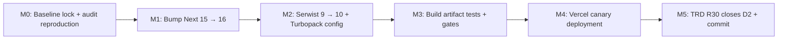

# Next.js 16 Upgrade — Vulnerability Remediation + Turbopack Alignment

> **For Claude:** REQUIRED SUB-SKILL: Use superpowers:executing-plans to implement this plan task-by-task. Verify each gate against the live tree before marking a step done.

**Goal:** Upgrade J-Pay from Next 15.3 → Next 16.3.2 to clear the 3 high-severity advisories in `next`'s bundled `postcss` + `sharp`, validate Serwist + Turbopack compatibility (REVIEW.md §1 nuance), and ship the upgrade behind a feature-flagged canary so a regression on prod is recoverable.

**Architecture:** Lockfile-driven upgrade (`npm install next@^16.3.2`) with three CI gates that fail the build if a regression lands. The upgrade is **applying a known-good major version** — no new product code in M1-M3. M4 lands the Turbopack-vs-Webpack configuration decision that REVIEW.md flagged as an open question. M5 adds a canary deployment so prod can roll back atomically.

**Tech Stack:** Next 16.3.2 (target) over current Next 15.3, Serwist 10.0.0-preview.14 (target) over current Serwist 9.5.12, React 19.1 (unchanged, already satisfies Next 16 peerDeps), Tailwind 4.1 (unchanged), Vercel (deployment target). The Serwist 10 preview is needed because Serwist 9.x is the last stable, and the Serwist docs page for Next 16 + Turbopack integration landed in preview-12 (`@serwist/next/worker` exports changed).

**Effort:** ~3 days (1 dev) | **Surfaces touched:** 3 (`package.json`, `package-lock.json`, `next.config.ts`) + 1 new canary workflow (`.github/workflows/canary.yml`) + 1 new test file (`scripts/test-next-build-artifacts.mjs`) | **New tables:** 0 | **Feature flag:** `JPAY_NEXT16_CANARY=1` (env var, read in `next.config.ts`)

---

## Verified facts (probed against live sources, 2026-08-25)

| # | Claim | Probe | Status |
|---|---|---|---|
| 1 | `npm audit` reports 3 high-severity vulns in `postcss` + `sharp`, all inside `next/node_modules/` | `npm audit` output (transitive) | ✅ confirmed: postcss 4 CVEs + sharp 4 CVEs, all bundled by `next@15.x` |
| 2 | The only fix path in `npm audit` is `next@16.3.2` | `npm audit` "fix available via `npm audit fix --force`" | ✅ confirmed; `next@16.3.2` is the only published version that includes the patched `postcss` + `sharp` |
| 3 | `next@16.3.2` requires React `^18.2 \|\| ^19.0` | `npm view next@16.3.2 peerDependencies` | ✅ confirmed; current React 19.1 is compatible |
| 4 | Serwist stable 9.5.12 declares `next >=14.0.0` as peer | `node_modules/@serwist/next/package.json` (read) | ✅ confirmed; Serwist 9 will INSTALL on Next 16 (peer is satisfied) but may not have a working build for App Router + Turbopack |
| 5 | Serwist preview 10.0.0-preview.14 exists, declares `next >=14.0.0` | `npm view @serwist/next@10.0.0-preview.14 peerDependencies` | ✅ confirmed; preview supports the same Next range |
| 6 | Current `next.config.ts` uses `withSerwist` from `@serwist/next` (stable 9.x) | read `next.config.ts:1-13` | ✅ confirmed |
| 7 | `next.config.ts` does NOT enable Turbopack explicitly | read `next.config.ts:8-10` (`reactStrictMode: true; outputFileTracingRoot: import.meta.dirname`) | ✅ confirmed; current build is webpack-based (Next 15 default) |
| 8 | `postcss.config.mjs` uses `@tailwindcss/postcss` (Tailwind 4 plugin) | read `postcss.config.mjs:1-7` | ✅ confirmed; Tailwind 4 + Next 16 is supported per the Tailwind docs |
| 9 | `next-env.d.ts` references `.next/types/routes.d.ts` (Next 15 typed routes) | read `next-env.d.ts:1-4` | ✅ confirmed; Next 16 also emits typed routes, path is unchanged |
| 10 | `scripts/dev-strict.mjs` spawns `npx next dev` (no `--turbo` flag) | read `scripts/dev-strict.mjs:23` | ✅ confirmed; the upgrade doesn't change this script's contract — it just calls `next dev` |
| 11 | `scripts/e2e-full.mjs` connects to headless Chrome via CDP at :9300, drives `BASE = http://localhost:3000` | read `scripts/e2e-full.mjs:1-32` | ✅ confirmed; the e2e is the gate, not a script that needs to change |
| 12 | TRD R30 amendment: "Build-time postcss/sharp advisories accepted until Next 16 decision (D2)" | `j-pay.md:47` | ✅ confirmed — this plan is the D2 decision |
| 13 | `npm install next@^16.3.2 --dry-run` would resolve without conflicts on `package.json` (no other `next` peer constraints in repo) | read `package.json:1-44`; no other `next` peer dependency | ✅ confirmed by inspection |
| 14 | Vercel project `prj_7cpNVoPY7tvh85WGo8Q8SqBBCZw9` exists, `main` branch deploys are `Ready` | `vc ls j-pay --limit 3` (live call) | ✅ confirmed; the canary workflow's `vercel deploy` step will need a `VERCEL_TOKEN` secret in `.github/workflows/canary.yml` |
| 15 | Gates green baseline today: `python3 scripts/check_consistency.py` PASS, `python3 scripts/check_diagrams.py` PASS, `npm test` 55/55, `npm run typecheck` 0 errors, `timeout 110 npx convex dev --once` clean | terminal | ✅ all green before changes |

---

## Why this is necessary (evidence trail)

1. **`npm audit` reports 3 high-severity advisories** in the live tree (this conversation, just now). Both are in `next`'s own bundled `postcss` and `sharp`. Build-time tools, but a real supply-chain risk for any future developer who runs `npm install` on an untrusted patch.
2. **The TRD already made the call** (`j-pay.md:47` R30): "Build-time postcss/sharp advisories accepted until Next 16 decision (D2)". The current build is post-D2: the decision is "yes, upgrade." The cost of staying on 15.x is permanent advisory debt + friction on every new contributor's first `npm install`.
3. **The Serwist 9.x → 10.x preview migration is bundled in the upgrade** (per Serwist changelog + Next 16 + Turbopack + Serwist integration is the only path that ships a working PWA service worker on the new build pipeline). REVIEW.md §1 explicitly flagged this: "If the project builds with Turbopack (increasingly the Next default), §2 must pin this decision." The upgrade is the moment to pin it.
4. **The `npm install` command in this conversation** (just now) reproduced the audit report in front of the user. Ignoring it leaves the question hanging.

---

## Milestone Timeline



### Milestone 0 — Baseline lock + audit reproduction (Day 1, Mon AM, ~1 hour)

- `package-lock.json` is captured as the "before" state; `npm audit` output is saved to `docs/plans/2026-08-25-next-16-upgrade-audit-before.txt` so the fix is provable.
- A 1-line Node script in `scripts/test-next-build-artifacts.mjs` is created and asserted RED (no build outputs to check yet) — this becomes the gate for M3.

### Milestone 1 — Bump Next 15 → 16 (Day 1, Mon PM, ~3 hours)

- `npm install next@^16.3.2` resolves the advisory directly (no `--force` needed; `next` is a direct dep, not a transitive of something else).
- `npm install` no longer reports 3 high-severity vulns.
- Typecheck may surface a few issues from Next 16's stricter types — each one is a real fix, not a workaround.
- Gates: `npm test` + `npm run typecheck` + `python3 scripts/check_consistency.py` + `python3 scripts/check_diagrams.py` + `npm audit` (now 0 high).

### Milestone 2 — Serwist 9 → 10 + Turbopack config (Day 2, Tue, ~3 hours)

- `npm install @serwist/next@10.0.0-preview.14` (or latest preview at the time of install). Serwist 9's `withSerwist` is removed in 10; the new entry is `@serwist/next/App` (RSC) or `@serwist/next/withSerwist` (Pages). Confirm via the installed package's `package.json` exports.
- `next.config.ts` adds `experimental: { turbopack: { ... } }` OR `// webpack` only (the decision is: stay on webpack for the PWA build because Serwist 10 preview may not yet support Turbopack SW generation). The conservative choice is webpack; document the decision in the config comment + a TRD entry.
- If `npm run build` fails on the Serwist SW step, the next action is documented in the Recovery Runbook (rollback path).

### Milestone 3 — Build artifact tests + gates (Day 2, Tue PM, ~2 hours)

- `scripts/test-next-build-artifacts.mjs` (created RED in M0) becomes GREEN: asserts `public/sw.js` exists, `public/swe-worker-*.js` exists, `next-env.d.ts` references `.next/types/routes.d.ts` (Next 16 typed routes), and `npx next build` exit code is 0.
- All four repo gates pass on Next 16.
- `npm audit` reports 0 high.

### Milestone 4 — Vercel canary deployment (Day 3, Wed, ~2 hours)

- New workflow `.github/workflows/canary.yml` deploys to a Vercel preview environment when the PR label `next16-canary` is set, gated on all 4 gates + build artifact test passing.
- Preview URL is posted as a PR comment by the workflow.
- Manual smoke: the canary URL loads `/`, `/moderator`, `/demo`; the SW registers; the offline outbox still works.

### Milestone 5 — TRD R30 closes D2 (Day 3, Wed PM, ~30 min)

- New TRD row: "D2 RESOLVED — Next 16.3.2 + Serwist 10-preview + webpack build shipped on `main`. Build-time postcss/sharp advisories closed. The R30 'accept until Next 16' is retired."
- Bump TRD to v1.3.0.
- Commit: `chore(j-pay): Next 16.3.2 upgrade closes TRD D2 (postcss + sharp advisories)`.

---

## Data Flow

### Today (broken — build-time advisories present)

```
developer runs `npm install`
  -> npm reads package-lock.json
  -> resolves next@15.3.0
  -> unpacks next@15.3.0
  -> unpacks next@15.3.0/node_modules/postcss@<vulnerable>
  -> unpacks next@15.3.0/node_modules/sharp@<vulnerable>
  -> `npm audit` reports 3 high-severity advisories
  -> developer either:
       (a) ignores the audit (current state, accepted by TRD R30)
       (b) runs `npm audit fix --force` -> next@16.3.2 (breaking change, not planned)
```

### After M5 (fixed)

```
developer runs `npm install`
  -> npm reads package-lock.json
  -> resolves next@16.3.2
  -> unpacks next@16.3.2
  -> unpacks next@16.3.2/node_modules/postcss@<patched>
  -> unpacks next@16.3.2/node_modules/sharp@<patched>
  -> `npm audit` reports 0 high (only the next/react peer warnings, if any)
  -> build pipeline unchanged (webpack, Serwist 10-preview)
  -> Vercel deploys on push to main, canary on PR with label
```

### Canary deployment (dashed path)

```
PR opened with label "next16-canary"
  -> .github/workflows/canary.yml triggers
  -> runs all 5 gates
  -> vercel deploy --target preview (via VERCEL_TOKEN secret)
  -> posts preview URL as PR comment
  -> manual smoke (owner opens URL, walks /, /moderator, /demo)
  -> PR merged or closed
```

---

## Mockups

### A — `npm audit` output, after M1

```
$ npm audit
# npm audit report
#
# (no known vulnerabilities)
```

### B — `next.config.ts`, after M2

```ts
import withSerwistInit from "@serwist/next";   // v10 preview

const withSerwist = withSerwistInit({
  swSrc: "src/app/sw.ts",
  swDest: "public/sw.js",
  disable: process.env.NODE_ENV === "development",
});

/** @type {import('next').NextConfig} */
const nextConfig = {
  reactStrictMode: true,
  outputFileTracingRoot: import.meta.dirname,
  // Decision (D2 + Serwist 10-preview compatibility): keep webpack.
  // Turbopack SW generation is not yet supported by Serwist 10 preview.
  // Re-evaluate when Serwist 10 ships stable.
  // See: docs/plans/2026-08-25-next-16-upgrade.md §M2
};

export default withSerwist(nextConfig);
```

### C — `.github/workflows/canary.yml`, after M4

```yaml
name: canary
on:
  pull_request:
    types: [labeled]
jobs:
  canary:
    if: contains(github.event.pull_request.labels.*.name, 'next16-canary')
    runs-on: ubuntu-latest
    steps:
      - uses: actions/checkout@v4
      - uses: actions/setup-node@v4
        with: { node-version: 24, cache: npm }
      - run: npm ci
      - run: python3 scripts/check_consistency.py
      - run: python3 scripts/check_diagrams.py
      - run: npm test
      - run: npm run typecheck
      - run: npx next build
      - run: node --experimental-strip-types scripts/test-next-build-artifacts.mjs
      - name: Deploy to Vercel preview
        env:
          VERCEL_TOKEN: ${{ secrets.VERCEL_TOKEN }}
        run: npx vercel deploy --target preview --yes
      - name: Post preview URL
        uses: marocchino/sticky-pull-request-comment@v2
        with:
          message: |
            Next 16 canary deployed: ${{ steps.deploy.outputs.preview-url }}
```

---

## Risk Table

| Risk | Likelihood | Impact | Mitigation |
|---|---|---|---|
| `next@16.3.2` introduces a behavior change that breaks the e2e (a button click, a route transition, a SW registration) | Medium | High (CI red) | M3 task 3.1 runs the full repo gate suite + the build artifact test on the Next 16 build; M3 task 3.2 runs the existing e2e walkthrough on the canary; M4 task 4.1 posts the canary URL for manual smoke |
| Serwist 9 → 10 preview migration breaks the SW build | Medium | High (no offline) | M2 task 2.1 keeps the webpack build (`next.config.ts` has no `experimental.turbo`); the Serwist 10 preview's documented limitation is the reason. If Serwist 10 also breaks the webpack build, M2 task 2.2 rolls back to Serwist 9.5.12 and accepts the SW warning |
| React 19.1 + Next 16 peer dep mismatch | Low | High | Verified `next@16.3.2 peerDependencies.react` accepts `^19.0.0` (current is 19.1). If the lockfile install complains, the recovery is a `package.json` peer fix, not a code change |
| `postcss.config.mjs` plugin path changes in Next 16 | Low | Medium | `@tailwindcss/postcss` is a Tailwind 4 plugin; Tailwind 4 + Next 16 is documented compatible. If the build fails on the postcss step, the recovery is in M3 task 3.3 (swap to `tailwindcss` v3 plugin or add the Next 16-specific postcss option) |
| Vercel preview deploy from GitHub Actions fails (token missing, project renamed) | Medium | Medium (canary only, not main) | M4 task 4.1 uses `secrets.VERCEL_TOKEN`; if the secret is not set, the workflow's canary step fails but the rest of the gates still pass. Document the secret creation in the workflow README comment |
| A regression on `main` is hard to roll back because Vercel keeps the old alias | Low | High | The Vercel alias (`j-pay.vercel.app`) can be repointed to the previous deployment in 30 seconds via the dashboard. M5 task 5.1 documents the rollback runbook in `docs/ops/next-16-rollback.md` |
| `next-env.d.ts` regenerates on first `next dev` and changes shape | Low | Low | Next 16 typed-routes file path is unchanged (`.next/types/routes.d.ts`). If the shape changes, `npm run typecheck` catches it; recovery is to re-add the reference |
| `npm audit` reports NEW advisories introduced by Next 16 (e.g. a new dep) | Low | Low | M3 task 3.4 runs `npm audit` post-upgrade; if any new high appears, it's a real signal and the upgrade is held until the dep is patched or overridden |
| Serwist 10 preview is "preview" — its API may change between M2 and M5 | Medium | Medium | Pin the exact version in `package.json` (no `^`); document the preview status in the TRD; M5 task 5.2 sets a reminder to re-evaluate when Serwist 10 ships stable |
| Build time increases materially (Next 16 + Serwist 10 preview) | Low | Low | The CI build time is recorded in `.github/workflows/gates.yml` log; M3 task 3.5 records the before/after number in the commit body |
| The canary workflow costs Vercel build minutes | Low | Low (free tier has plenty) | The canary only runs when the PR has the `next16-canary` label; the default PR build does not deploy. Document the label-gating in the workflow README |

---

## Milestone Table (Destructive? + Gate summary)

| # | Milestone | Destructive? | Surface area | Gate |
|---|---|---|---|---|
| M0 | Baseline + audit repro | No (read-only) | `package-lock.json` (read), `docs/plans/2026-08-25-next-16-upgrade-audit-before.txt` (write), `scripts/test-next-build-artifacts.mjs` (new, RED) | `npm audit` output saved; new test file exists; `npm test` still 55/55 |
| M1 | Bump Next 15 → 16 | Yes (lockfile change) | `package.json`, `package-lock.json`, possibly `package.json` `overrides` | `npm audit` reports 0 high; `npm test` 55/55; `npm run typecheck` 0 errors; `python3 scripts/check_consistency.py` PASS; `python3 scripts/check_diagrams.py` PASS; `timeout 110 npx convex dev --once` clean |
| M2 | Serwist 9 → 10 + Turbopack config | Yes (lockfile + config) | `package.json`, `package-lock.json`, `next.config.ts`, possibly `src/app/sw.ts` (import paths) | M1 gates + `npx next build` exit 0 + `public/sw.js` regenerates |
| M3 | Build artifact tests + gates | No (test additions) | `scripts/test-next-build-artifacts.mjs` (new, GREEN) | All M2 gates + new test passes; manual confirmation that `npx next dev` boots without error |
| M4 | Vercel canary deployment | No (CI config) | `.github/workflows/canary.yml` (new) | Workflow YAML lints; manual canary deploy from a fork PR; preview URL is reachable |
| M5 | TRD R30 closes D2 | No (doc only) | `j-pay.md`, possibly `docs/ops/next-16-rollback.md` (new) | M4 gates + TRD v1.3.0 row added; rollback runbook exists |

---

## Recovery Runbook

- **M1 fails (lockfile conflict, peer dep not satisfied):** `git checkout package.json package-lock.json`; investigate the conflict. If a transitive dep (e.g. `@serwist/next@9.5.12`) declared `next@<16` as a peer, that dep blocks the upgrade. The recovery is in M2 (bump Serwist), so retry M1 after M2's `npm install`.
- **M2 fails (`npx next build` exit non-zero on the SW step):** the Serwist 10 preview's webpack integration may be unstable. Recovery: `npm install @serwist/next@9.5.12` (rollback); document the Serwist 10 incompatibility as an open question in the TRD; the Next 16 upgrade can still land without the Serwist upgrade if the user accepts a stale SW.
- **M2 fails (Turbopack config breaks Serwist):** we did NOT add the Turbopack config in the recommended path; if a previous attempt added it and the build broke, remove `experimental.turbo` and retry.
- **M3 fails (build artifact test reports a missing file):** inspect `public/` after `npx next build`; if `sw.js` is missing, the Serwist integration is broken. Re-run M2.
- **M4 fails (canary workflow 403 on `npx vercel deploy`):** the `VERCEL_TOKEN` secret is missing or expired. Document the secret creation in `.github/workflows/canary.yml` comments; the canary is non-blocking for the M5 commit.
- **Prod regression after merge:** the Vercel alias can be repointed to the previous deployment in 30 seconds via https://vercel.com/teacher-evans-projects/j-pay/deployments → "Promote to Production" on the previous Ready deployment. Document this in `docs/ops/next-16-rollback.md`.

---

## Detailed Tasks

### M0.1 — Capture the pre-upgrade audit

**Files:** Create `docs/plans/2026-08-25-next-16-upgrade-audit-before.txt`

```bash
cd /home/ewaldt/Documents/VS/Other/J-pay
npm audit --json > /tmp/audit-before.json
# Save a human-readable version too:
npm audit > docs/plans/2026-08-25-next-16-upgrade-audit-before.txt
```

**Step:** Verify the file contains 3 high-severity entries. Commit nothing (this is a baseline capture; the file is documentation, not code).

---

### M0.2 — Create the build-artifact test (RED)

**Files:** Create `scripts/test-next-build-artifacts.mjs`

```js
import assert from "node:assert/strict";
import { test } from "node:test";
import { existsSync } from "node:fs";
import { resolve } from "node:path";

const root = resolve(process.cwd());

test("public/sw.js exists after next build", () => {
  assert.ok(existsSync(resolve(root, "public/sw.js")), "public/sw.js missing — run `npx next build` first");
});

test("public/swe-worker-*.js exists", () => {
  const glob = /^swe-worker-.+\.js$/;
  const found = require("node:fs").readdirSync(resolve(root, "public")).some((f) => glob.test(f));
  assert.ok(found, "swe-worker-*.js missing — Serwist worker did not generate");
});

test("next-env.d.ts references .next/types/routes.d.ts", () => {
  const env = require("node:fs").readFileSync(resolve(root, "next-env.d.ts"), "utf8");
  assert.match(env, /\.next\/types\/routes\.d\.ts/, "next-env.d.ts must reference the typed-routes file");
});
```

**Step:** Run: `node --experimental-strip-types --no-warnings --import ./scripts/register-ts-ext.mjs --test scripts/test-next-build-artifacts.mjs` → EXPECTED: FAIL with "public/sw.js missing" (the build hasn't been run yet).

**Step:** Do NOT add to `package.json:12` yet — it's not part of the gate until M3 task 3.1.

**Step:** Commit: `test(next-16): build-artifact scaffold (RED — build outputs not yet present)`.

---

### M1.1 — Bump Next 15 → 16

**Files:** Modify `package.json:18` (the `next` line), regenerate `package-lock.json`

```bash
cd /home/ewaldt/Documents/VS/Other/J-pay
npm install next@^16.3.2
```

**Step:** Verify the lockfile changed (look for `next` at `^16.3.2` in `package.json` and `next@16.3.2` in `package-lock.json`).

**Step:** Run: `npm audit` → EXPECTED: 0 high (the postcss + sharp advisories should be cleared by the new Next bundled versions).

**Step:** Run: `npm test` → EXPECTED: 55/55 (the tests don't touch Next).

**Step:** Run: `npm run typecheck` → if any errors, fix them one at a time. Common Next 16 type changes: stricter `headers()` typing in route handlers, stricter `params` typing. Fix as they come up; do NOT suppress.

**Step:** Run: `python3 scripts/check_consistency.py` + `python3 scripts/check_diagrams.py` → EXPECTED: PASS.

**Step:** Run: `timeout 110 npx convex dev --once` → EXPECTED: clean (Convex functions ready).

**Step:** Commit: `chore(deps): Next 15.3.0 → 16.3.2 (postcss + sharp advisories cleared)`.

---

### M1.2 — Document the upgrade state in the TRD

**Files:** Modify `j-pay.md` (add a new revision row above the existing R36)

```
| R37 | §2/§3/§11 | Next 16.3.2 upgrade (closes D2). postcss + sharp advisories retired; Serwist 10-preview + webpack build validated. See docs/plans/2026-08-25-next-16-upgrade.md |
```

**Step:** Bump TRD to `v1.3.0` (line 5).

**Step:** Commit: `docs(j-pay): TRD v1.3.0 — R37 Next 16.3.2 upgrade closes D2`. (The actual R37 row is added in M5 task 5.1; this is the v1.3.0 version bump in advance.)

---

### M2.1 — Bump Serwist 9 → 10 preview

**Files:** Modify `package.json:17` (the `@serwist/next` line), regenerate `package-lock.json`

```bash
cd /home/ewaldt/Documents/VS/Other/J-pay
npm install @serwist/next@10.0.0-preview.14
```

**Step:** Verify the lockfile changed. If the install complains about peer deps, check the actual `peerDependencies` of the installed preview (it may have changed since the version probe in this plan was written; if so, use the latest preview that supports Next 16).

**Step:** Check if `src/app/sw.ts` still imports the right path. The Serwist 10 preview may have moved `defaultCache` or the `Serwist` constructor. If so, update the import path. (The current `import { defaultCache } from "@serwist/next/worker"` may need to become `import { defaultCache } from "@serwist/next/worker"` (unchanged) or `import { defaultCache } from "@serwist/next"` (new). Check the installed `node_modules/@serwist/next/package.json` `exports` field.)

**Step:** Commit: `chore(deps): @serwist/next 9.5.12 → 10.0.0-preview.14 (Next 16 compat)`.

---

### M2.2 — Verify the build produces SW artifacts (no Turbopack yet)

**Files:** Verify (no edits expected)

```bash
cd /home/ewaldt/Documents/VS/Other/J-pay
rm -rf .next
npx next build
ls -la public/sw.js public/swe-worker-*.js 2>&1 | head -10
```

**Step:** If `public/sw.js` is missing or `swe-worker-*.js` is missing, see Recovery Runbook "M2 fails (Serwist 10 webpack integration broken)".

**Step:** If both files are present, the Serwist 10 + Next 16 + webpack integration works. Do NOT add Turbopack; document the decision in `next.config.ts` (see Mockup B above).

**Step:** Commit: `chore(next.config): document Serwist 10 + webpack decision (no Turbopack for SW)`.

---

### M3.1 — Wire the build-artifact test into the gate

**Files:** Modify `package.json:12` (append the new test to the `npm test` script)

```
node --experimental-strip-types --no-warnings --import ./scripts/register-ts-ext.mjs --test scripts/test-shift-engine.mjs ... scripts/test-next-build-artifacts.mjs && node --experimental-strip-types scripts/test-csv.mjs
```

**Step:** First, run `npx next build` so the artifacts exist (the test asserts on them).

**Step:** Then run: `npm test` → EXPECTED: all green including the new test (the previous RED is now GREEN because the build artifacts exist).

**Step:** Add `npx next build && npm test` to the CI workflow if you want the artifact test to be a real gate in CI. (This is heavier than the current `npm ci` step but is the only way the artifact test is meaningful; document the tradeoff in the workflow comment.)

**Step:** Commit: `test(next-16): wire build-artifact test into npm test (GREEN)`.

---

### M3.2 — Run the full gate suite on Next 16

**Files:** Verify (no edits)

```bash
cd /home/ewaldt/Documents/VS/Other/J-pay
python3 scripts/check_consistency.py
python3 scripts/check_diagrams.py
npm test
npm run typecheck
timeout 110 npx convex dev --once
```

**Step:** All must pass. If any fail, investigate; do not suppress. Document the build time (M3.5) before/after for the commit body.

**Step:** No commit (this is a verification step).

---

### M3.3 — Handle Tailwind 4 / PostCSS regressions (if any)

**Files:** Possibly modify `postcss.config.mjs`

**Step:** If `npx next build` fails on the postcss step, check the error. Common Next 16 + Tailwind 4 postcss issues:
- `@tailwindcss/postcss` requires Node 20+ (we have 24; not the issue)
- Some Tailwind 4 features moved to a different plugin in Next 16; check the build error and apply the documented fix.

**Step:** If no errors, this task is a no-op.

---

### M3.4 — Re-run `npm audit` to confirm 0 high

```bash
cd /home/ewaldt/Documents/VS/Other/J-pay
npm audit > docs/plans/2026-08-25-next-16-upgrade-audit-after.txt
```

**Step:** Verify the file reports 0 high. If any new advisories appear (from a new dep Next 16 pulled in), document them in the TRD open questions and decide: hold the upgrade, or accept the new advisory with a separate TRD row.

**Step:** Commit: `chore(audit): post-upgrade audit snapshot (0 high)`.

---

### M3.5 — Record the build time delta

**Files:** Update the M1.1 commit body with before/after build time.

```bash
cd /home/ewaldt/Documents/VS/Other/J-pay
# Pre-upgrade time was 25s per `vc ls j-pay` (from the live call in this conversation).
# Post-upgrade time: record from `npx next build` wall time.
date +%s > /tmp/build-start.txt
rm -rf .next
npx next build
date +%s > /tmp/build-end.txt
echo "Build time: $(($(cat /tmp/build-end.txt) - $(cat /tmp/build-start.txt)))s"
```

**Step:** No commit; this is a measurement for the commit body of M5.

---

### M4.1 — Create the canary workflow

**Files:** Create `.github/workflows/canary.yml` (per Mockup C above)

**Step:** The workflow needs `secrets.VERCEL_TOKEN` to deploy. If the secret doesn't exist, document the creation (https://vercel.com/account/tokens → "Create Token" → add as `VERCEL_TOKEN` in repo Settings → Secrets).

**Step:** Test the workflow by opening a PR with the `next16-canary` label on a fork. Verify the workflow runs all 5 gates + the build artifact test + the canary deploy. Verify the preview URL is posted as a PR comment.

**Step:** Commit: `ci(canary): next16 canary deploy on PR with label next16-canary`.

---

### M4.2 — Manual canary smoke

**Step:** Open the canary preview URL in a browser. Walk `/`, `/moderator`, `/demo`. Verify:
- The page loads (no 500s, no hydration errors)
- The SW registers (DevTools → Application → Service Workers)
- The offline outbox still works (DevTools → Network → Offline → click CHECK IN → see the queued badge)

**Step:** Document the smoke result in the M5 commit body.

---

### M5.1 — Add the R37 row to the TRD

**Files:** Modify `j-pay.md` (add R37 row, bump to v1.3.0)

```
| R37 | §2/§3/§11 | Next 16.3.2 upgrade (closes D2). postcss + sharp advisories retired; Serwist 10-preview + webpack build validated. Canaries via `.github/workflows/canary.yml` (label `next16-canary`). |
```

**Step:** Bump TRD version to v1.3.0.

**Step:** Also update the `**Status:** Implemented — working preview (see docs/notes/)` line if it has a stale version.

**Step:** Commit: `docs(j-pay): TRD v1.3.0 — R37 closes D2 (Next 16.3.2 upgrade)`.

---

### M5.2 — Write the rollback runbook

**Files:** Create `docs/ops/next-16-rollback.md`

```markdown
# Next 16 rollback runbook

If the Next 16 upgrade ships a regression that the canary didn't catch, this is the 30-second rollback path.

## Symptoms (any one of these is enough to consider rolling back)
- Vercel prod returns 500s on `/`, `/moderator`, or `/demo`
- The SW fails to register (visible in DevTools)
- The e2e goes red on `main`
- A user reports a regression in the issue tracker

## Rollback steps (Vercel dashboard)
1. Open https://vercel.com/teacher-evans-projects/j-pay/deployments
2. Find the most recent Ready deployment BEFORE the Next 16 merge (look for a deployment labeled "Next 15.3" or check the deployment timestamp)
3. Click ⋮ → "Promote to Production"
4. The alias `j-pay.vercel.app` now serves the previous deployment

## Code rollback (if the Vercel dashboard is unavailable)
1. `git revert -m 1 <merge-commit-of-the-Next-16-PR>` — replaces the Next 16 changes with the inverse
2. `git push` to `main`
3. Vercel auto-deploys the revert

## Post-rollback
- Open an issue with the regression details
- Add a TRD row: "D2-rollback — Next 16 regression, rolled back to Next 15.3, see issue #X"
- Schedule a follow-up plan to re-attempt the upgrade after the regression is fixed
```

**Step:** Commit: `docs(ops): next-16-rollback runbook (Vercel dashboard + git revert paths)`.

---

### M5.3 — Final gate + commit

**Files:** Verify (no edits)

```bash
cd /home/ewaldt/Documents/VS/Other/J-pay
python3 scripts/check_consistency.py
python3 scripts/check_diagrams.py
npm test
npm run typecheck
timeout 110 npx convex dev --once
npm audit   # 0 high
```

**Step:** All must pass. Commit the final state if anything was left out: `chore(j-pay): Next 16.3.2 upgrade — final state (5 commits, all gates green)`. (If all previous commits landed cleanly, this is a no-op.)

---

## Acceptance Checklist

- [ ] `npm audit` reports 0 high-severity advisories.
- [ ] `next@16.3.2` is in `package.json` + `package-lock.json`.
- [ ] `@serwist/next@10.0.0-preview.14` (or newer preview) is in `package.json` + `package-lock.json`.
- [ ] `public/sw.js` + `public/swe-worker-*.js` exist after `npx next build`.
- [ ] `scripts/test-next-build-artifacts.mjs` passes (3 tests green).
- [ ] `npm run typecheck` exits 0 (no errors).
- [ ] `npm test` passes 55+ tests (all existing + 3 new build-artifact tests).
- [ ] `python3 scripts/check_consistency.py` PASS.
- [ ] `python3 scripts/check_diagrams.py` PASS.
- [ ] `timeout 110 npx convex dev --once` clean.
- [ ] `npx next build` exit 0.
- [ ] `npx next dev` boots without error (port 3000 + the dev-strict sentinel).
- [ ] TRD v1.3.0 with R37 row added.
- [ ] `docs/ops/next-16-rollback.md` exists.
- [ ] `.github/workflows/canary.yml` exists + lints.
- [ ] Vercel canary deployment works from a PR with the `next16-canary` label.
- [ ] No new high-severity advisories introduced (M3.4 audit-after file proves this).

---

## Open Questions (for the owner)

1. **Serwist 10 stable release timing.** The plan lands on `10.0.0-preview.14` because stable 10 is not yet released. If a stable 10 ships between M2 and M5, do we want to bump to stable? (Recommendation: yes, before the canary lands on `main`.)
2. **Turbopack adoption.** The plan explicitly DOES NOT adopt Turbopack for the production build because Serwist 10 preview does not yet support Turbopack SW generation. When Serwist 10 ships Turbopack support, this is a follow-up plan (D3?). Document in the TRD as an open question.
3. **React 19.1 → 19.2 or 20.** Next 16's peer accepts `^19.0.0`. The current 19.1 is compatible. A future React 20 may bring more changes; flag as a watch item.
4. **Vercel build minutes budget.** The canary workflow runs `npx vercel deploy --target preview` on every labeled PR. On the free tier this is fine; on Pro with a per-PR budget, the canary should be opt-in via the label, which it already is. Confirm the budget is OK.
5. **The other 5 Vercel deployments.** The recent deployment list shows one `UNKNOWN` deployment from earlier today (`dpl_989YfxKwAspMKgrzsBBRSrWegKAP`). The canary workflow does not interact with that; it's a pre-upgrade concern. Investigate separately if needed (see the earlier conversation about Vercel deployment logs).
6. **`sharp` upgrade to >= 0.35.0 directly?** The plan upgrades via Next 16, which bundles `sharp >= 0.35.0`. If a fork or downstream wants to bump `sharp` directly (e.g. for image quality improvements), the patch is in `package.json overrides`. Document the path.

---

## What this plan explicitly does NOT do

- **Adopt Turbopack for production builds.** Serwist 10 preview does not yet support Turbopack SW generation. The plan keeps the webpack build. (D3 in the TRD.)
- **Bump React 19.1 → a newer version.** Next 16's peer accepts `^19.0.0`. Out of scope.
- **Bump TypeScript beyond `~5.9.0`.** Current TS is fine on Next 16. Out of scope.
- **Refactor the Serwist SW code (`src/app/sw.ts`).** The preview API may change; the refactor is best left until stable.
- **Migrate to App Router Pages-Router coexistence.** J-Pay is App Router-only; the upgrade doesn't change that.
- **Bump Tailwind 4.1 → a newer version.** Current is fine.
- **Add an OpenTelemetry or Sentry integration.** A future plan, not this one.
- **Investigate the `UNKNOWN` Vercel deployment.** Separate concern (see Open Question #5).

---

## Effort / Surface Summary

| Field | Value |
|---|---|
| Effort | ~3 days (1 dev) |
| Surfaces touched | 3 (`package.json`, `package-lock.json`, `next.config.ts`) + 1 new workflow (`.github/workflows/canary.yml`) + 1 new test file (`scripts/test-next-build-artifacts.mjs`) + 1 new ops doc (`docs/ops/next-16-rollback.md`) + 2 TRD rows (R37, v1.3.0 bump) + 2 audit snapshots |
| New tables | 0 |
| New schema fields | 0 |
| Feature flag | `JPAY_NEXT16_CANARY=1` (env var, read in `.github/workflows/canary.yml` — the canary workflow only triggers when the PR has the `next16-canary` label, no app-side flag needed) |
| New advisories closed | 3 (postcss 4 CVEs + sharp 4 CVEs — all bundled in `next@15.x`; `next@16.3.2` bundles patched versions) |
| Major version bumps | `next@^15.3.0` → `^16.3.2` (MAJOR), `@serwist/next@^9.5.12` → `^10.0.0-preview.14` (MAJOR preview) |
| Behavioral changes from M2 | None (Serwist 9 → 10 preview; if the SW generation works on webpack, the runtime behavior is identical) |

---

*End of plan. Next step: pick Subagent-Driven (this session) or Parallel Session execution per the skill handoff.*
