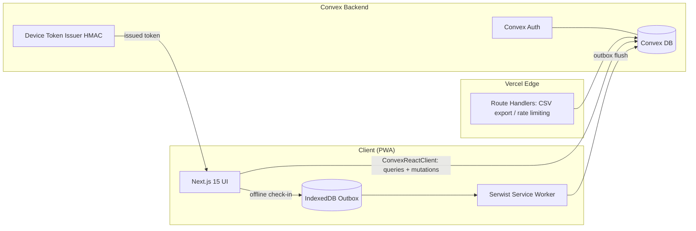
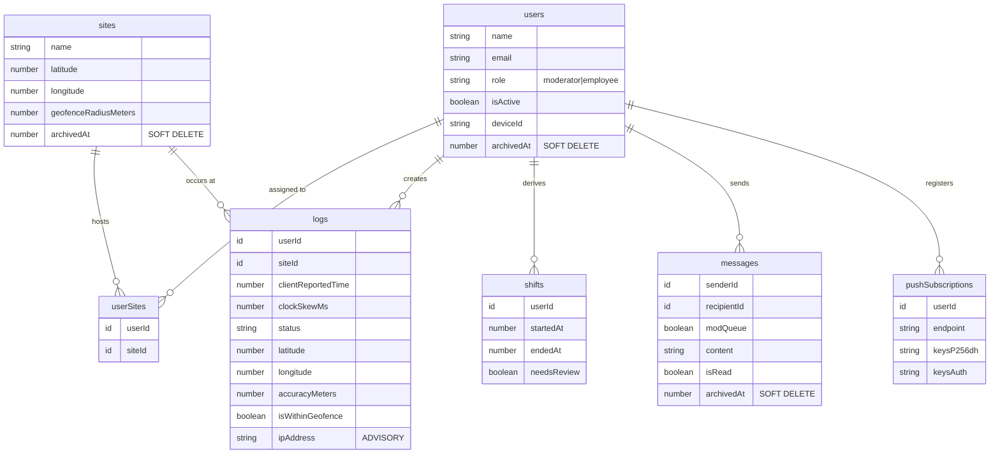
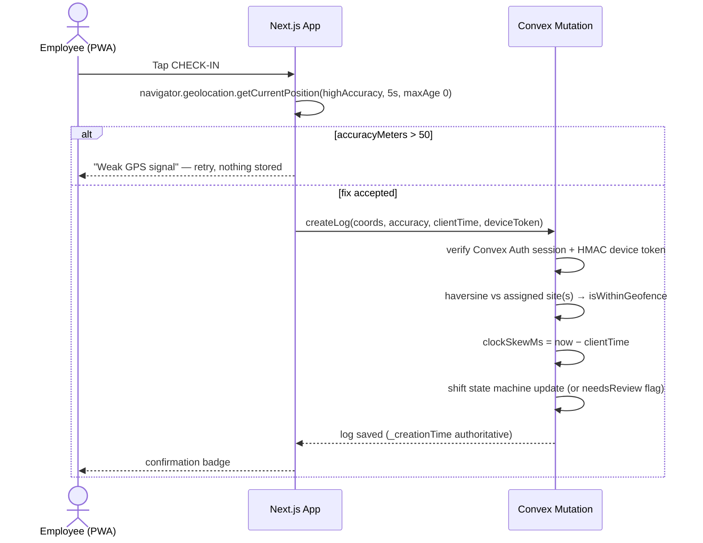
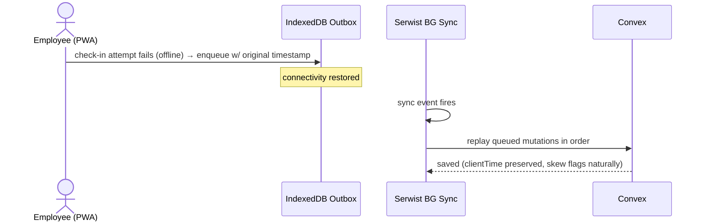
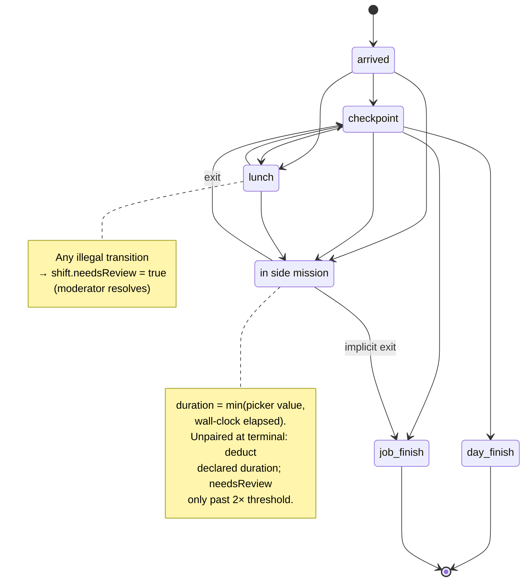

# J-Pay — Technical Requirements Document (TRD)

**Project:** PWA Payroll & Geolocation Logger
**Repository:** TeacherEvan/J-pay-webb_logger
**Version:** 1.1 (senior-review revision)
**Status:** Draft for review

### Revision Log (v1.1)

| # | Section | Change |
|---|---|---|
| R1 | §5.1/§6 | Side mission defined as substate; grammar extended (was illegal transition → needsReview flood) |
| R2 | §5.1 | Weak-GPS moderator override path added |
| R3 | §5.3 | Device token cloneability documented; issuance preconditions + WebAuthn upgrade path |
| R4 | §7 | Row-scoped authz hard rule (`ctx.auth` only, never client-supplied userId) |
| R5 | §6 | Schema: `logs.idempotencyKey`, `logs.siteTimezone`, `logs.impossibleTravelFlag`, `sites.timezone` |
| R6 | §6.1 | Shift grammar: skew-corrected sort, idempotency dedupe, 16h auto-close, overnight/DST rules |
| R7 | §8 | Offline replay ordering rule |
| R8 | §7 | Impossible-travel heuristic (>200 km/h between fixes) |
| R9 | §9 | Retention enforced by Vercel Cron → Convex purge mutation |
| R10 | §5.2 | CSV formula-injection sanitization + pagination vs 4.5MB cap |
| R11 | §7 | clockSkewMs stored at write → indexable |
| R12 | §5.2 | Push subscription pruning on 404/410 |
| R13 | §4 | Consent modal links privacy notice |
| R14 | §11 | Open Questions updated |

---

## 1. Overview

J-Pay is a Progressive Web App for field-employee time tracking and payroll. Employees check in/out with GPS-verified timestamps; moderators audit locations in real time, manage constraints, compute payroll over derived shifts, and export CSV reports. Built mobile-first for employees, desktop-optimized for moderators.

### 1.1 Conflict Rule

The embedded schema (§6) is the source of truth. Where feature specifications and schema disagree, the schema wins and the discrepancy is flagged in §11 Open Questions.

---

## 2. Stack Requirements

| Layer | Technology |
|---|---|
| Frontend | Next.js 15 (App Router), TypeScript, Tailwind CSS, shadcn/ui |
| Backend/DB | Convex (reactive database, file storage, real-time sync) |
| Auth | **Convex Auth** (`@convex-dev/auth`, registry-verified v0.0.95 2026-08-11) with password provider; sessions via `ctx.auth`. Roles (`moderator` \| `employee`) stored on the `users` row and enforced server-side. Moderator provisioning = invite-only internal mutation (no self-signup route shipped). |
| Deployment | Vercel (Edge network). Client applications connect **directly to Convex** via `ConvexReactClient` using the public `NEXT_PUBLIC_CONVEX_URL`, authenticated with Convex Auth sessions. Vercel Route Handlers exist only for secret-free server conveniences: CSV export assembly and edge rate-limiting (device-token issuance moves INTO Convex per Task 7/M5). Data isolation comes from row-scoped authz inside every Convex function (§7 R4), never from URL concealment. |
| PWA | Serwist (service worker generation, manifest caching, Background Sync) |

---

## 3. Hard Technical Limits

The architecture is designed around these limits explicitly:

1. **Geolocation:** `navigator.geolocation` with `enableHighAccuracy: true`, `timeout: 5000`, `maximumAge: 0`. Any fix with `accuracyMeters > 50` is **rejected**; UI surfaces a "weak GPS signal" state instead of storing junk data.
2. **Convex mutations:** payloads must not exceed the **1MB** transaction limit.
3. **Vercel functions:** **10s** execution timeout; response payload cap **4.5MB**.
4. **Service worker cache:** budget < **50MB** for core app assets, with an LRU eviction strategy on runtime caches.
5. **Web Push:** encrypted message payload ≤ **4KB**. Notifications are trigger-only; clients fetch real content after wake.
6. **IP address is advisory telemetry only.** It must never be documented or implemented as an enforcement control — clients can bypass edge checks and spoof headers. See §7 Security.

---

## 4. Application Initialization

- Capture `beforeinstallprompt`; suppress default; show custom install UI.
  - **iOS reality:** no programmatic install prompt exists. Show manual "Add to Home Screen" instructions when iOS is detected.
- Initial loading screen: animated J-Pay logger SVG/CSS logo reveal.
- Consent modal enforcing geolocation + localstorage permissions. Copy: **"All work, no ads!"**
  - The modal MUST link the full privacy notice (data collected, lawful basis, retention, worker rights per §9). The modal alone is transparency shorthand, not the notice.
  - NOTE: employment-context consent is legally weak (GDPR Art. 7 power imbalance). The data-governance section (§9) cites **legitimate interest** as the lawful basis for location processing, with this modal serving as transparency notice only.

---

## 5. Feature Specifications

### 5.1 Employee Interface (Mobile-First)

- Single prominent **CHECK-IN** button: records GPS coords, accuracy radius, UTC timestamp (server time authoritative), device metadata.
- Quick-add status badges matching `logs.status` exactly:
  `["checkpoint", "lunch", "arrived", "day finish", "job finish", "feeling sick", "quick side mission"]` + side-mission duration picker.
- **Side mission semantics (v1.1):** a side mission is a **substate**, not a standalone event. Tapping it writes a log with status `quick side mission` + duration; the shift engine (§6.1) treats it as entering a substate that must be exited by the next `checkpoint` or `job finish`. Duration is deducted from worked minutes. It is a legal transition from any active state.
- **Weak-GPS override (v1.1):** fixes with `accuracyMeters > 50` are rejected client-side, but a moderator can manually attest a check-in (mod UI: employee + site + time → creates a log with `isModeratorOverride: true`). Without this, basement/indoor sites generate zero records and payroll disputes have no evidence trail.
- One-way messaging to Moderator queue.
- Web Push reminders + approval alerts.
- **Offline mode:** failed check-ins enqueue to an IndexedDB outbox and replay via Serwist Background Sync when connectivity returns. Original client timestamps are preserved and flagged through `clientReportedTime` delta.

### 5.2 Moderator Interface (Desktop-Optimized)

- Access provisioned backend-only (invite-only internal Convex mutation sets role; not self-service).
- Real-time audit log of employee locations (Convex reactive queries).
- Payroll calculator over derived **shifts** (§6), editable hourly rates and multipliers.
- Lightweight diagram tool (canvas or mermaid render-only).
- Constraint management: geofence radius per site assignment; IP ranges displayed as advisory signals, clearly labeled non-enforcing.
- Two-way messaging: Mod-to-Mod broadcast; Mod-to-Employee direct (Convex reactive queries).
- Reporting: CSV export by employee + date range (uses `by_user_time` index).
  - **Formula-injection sanitization (v1.1):** any cell value beginning with `=`, `+`, `-`, or `@` is prefixed with `'` on export (employee names, message content are attacker-controllable).
  - **Pagination (v1.1):** exports paginate on `by_user_time` and stream chunks; a single response must never approach the 4.5MB Vercel cap.
- **Push subscription maintenance (v1.1):** when a push send returns 404/410, delete the `pushSubscriptions` row. Without pruning, dead endpoints accumulate indefinitely.
- **Moderator manual check-in attestation (v1.1):** override flow for weak-GPS sites (see §5.1).

### 5.3 Device Binding

- Server-issued signed device token (HMAC, secret held solely in Convex env), stored in IndexedDB, verified server-side on each mutation.
- **Issuance preconditions (v1.1):** tokens are issued **inside Convex** (internal mutation at activation). Issuance requires a valid Convex Auth session for an invited `role === "employee"` user with `isActive === true`; self-signup route is not shipped (moderator invite-only provisioning). If edge issuance is ever required for rate-limiting, that reintroduces a second secret surface — rejected per review M5 unless documented need arises.
- **Known limitation (v1.1):** an IndexedDB-stored HMAC token proves *possession*, not *device* — any employee can extract their own token via DevTools and share it (buddy punching). Moderators MUST treat duplicate-token usage across distinct devices/IPs as a fraud signal. Optional hardening: WebAuthn platform authenticator (`authenticatorAttachment: "platform"`) for hardware-backed identity on modern Android/iOS; recommended Phase 2.
- Loss of device = moderator-triggered re-issue flow.
- A localStorage copy alone is **NOT** sufficient identity.

---

## 6. Data Model

```ts
import { defineSchema, defineTable } from "convex/server";
import { v } from "convex/values";

export default defineSchema({
  users: defineTable({
    name: v.string(),
    email: v.string(),
    role: v.union(v.literal("moderator"), v.literal("employee")),
    isActive: v.boolean(),
    deviceId: v.optional(v.string()),          // signed device token id
    archivedAt: v.optional(v.number()),        // soft delete (payroll compliance)
    hourlyRateOverride: v.optional(v.number()),
    pushSubscriptionTokens: v.optional(v.array(v.string())),
  })
    .index("by_email", ["email"])
    .index("by_role", ["role"])
    .index("by_active", ["isActive"]),

  sites: defineTable({
    name: v.string(),
    latitude: v.number(),
    longitude: v.number(),
    geofenceRadiusMeters: v.number(),
    timezone: v.string(),                      // IANA tz — payroll day boundaries are LOCAL (v1.1)
    archivedAt: v.optional(v.number()),
  }),

  userSites: defineTable({                     // employees assigned to one+ sites
    userId: v.id("users"),
    siteId: v.id("sites"),
  })
    .index("by_user", ["userId"])
    .index("by_site", ["siteId"]),

  logs: defineTable({
    userId: v.id("users"),
    siteId: v.id("sites"),
    // Server _creationTime is authoritative. clientReportedTime exists to
    // detect clock tampering delta only.
    clientReportedTime: v.number(),
    clockSkewMs: v.optional(v.number()),       // computed at write; mods filter |skew| > 30000
    status: v.union(
      v.literal("arrived"),
      v.literal("checkpoint"),
      v.literal("lunch"),
      v.literal("feeling sick"),
      v.literal("day finish"),
      v.literal("job finish"),
      v.literal("quick side mission")
    ),
    latitude: v.number(),
    longitude: v.number(),
    accuracyMeters: v.number(),                // rejected if > 50 at write time
    isWithinGeofence: v.boolean(),             // haversine computed strictly server-side
    sideMissionDurationMinutes: v.optional(
      v.union(v.literal(15), v.literal(30), v.literal(45), v.literal(60), v.literal(120))
    ),
    deviceMetadata: v.string(),
    ipAddress: v.optional(v.string()),         // ADVISORY ONLY — never enforcement
    idempotencyKey: v.string(),                // client-generated UUID per button press; mutation dedupes (v1.1)
    isModeratorOverride: v.optional(v.boolean()), // manual attestation for weak-GPS sites (v1.1)
    impossibleTravelFlag: v.optional(v.boolean()), // >200 km/h vs previous fix (v1.1)
  })
    .index("by_user_time", ["userId", "_creationTime"])
    .index("by_status", ["status"])
    .index("by_site_time", ["siteId", "_creationTime"]),

  shifts: defineTable({                        // DERIVED cache; logs are truth
    userId: v.id("users"),
    startedAt: v.number(),
    endedAt: v.optional(v.number()),
    totalMinutes: v.optional(v.number()),
    needsReview: v.boolean(),                  // malformed/out-of-order sequences land here
    reviewReason: v.optional(v.string()),
  })
    .index("by_user_start", ["userId", "startedAt"])
    .index("by_needs_review", ["needsReview"]),

  messages: defineTable({
    senderId: v.id("users"),
    recipientId: v.optional(v.id("users")),
    modQueue: v.boolean(),                     // do NOT rely on recipientId absence — not indexable
    content: v.string(),
    isRead: v.boolean(),
    archivedAt: v.optional(v.number()),        // archive ≠ delete; retention per §9
    retentionDays: v.optional(v.number()),
  })
    .index("by_recipient_read", ["recipientId", "isRead"])
    .index("by_modqueue_unread", ["modQueue", "isRead"]),

  pushSubscriptions: defineTable({             // one row per subscription → rotation/dedup
    userId: v.id("users"),
    endpoint: v.string(),
    keysP256dh: v.string(),
    keysAuth: v.string(),
  })
    .index("by_user", ["userId"]),
});
```

### 6.1 Shift Derivation Grammar (strict)

Legal transitions:

```
(arrived | job finish) → checkpoint? → lunch → checkpoint (resume)
→ ... → day finish | job finish
quick side mission: legal from ANY active state; enters a substate
  exited by the next checkpoint or job finish; picker duration deducted
  from worked minutes
```

Derivation rules (v1.1):

1. **Ordering:** candidate logs are sorted by `clientReportedTime` skew-corrected (`clientReportedTime` when `|clockSkewMs| <= 30000`, else `_creationTime`). NEVER derive order from `_creationTime` alone — offline replay and multi-device use produce out-of-order server arrival.
2. **Dedupe:** `idempotencyKey` duplicates are dropped before state-machine evaluation (double-tap / network retry protection).
3. **Auto-close:** a shift with no terminal event (`day finish`/`job finish`) by `startedAt + MAX_SHIFT_HOURS (16h)` is auto-closed with `needsReview = true`, reason `"auto_closed_no_terminal"`.
4. **Unpaired lunch:** a `lunch` without a resuming `checkpoint` deducts the site's default lunch minutes (configurable, default 60) — not needsReview unless it exceeds 2× default.
5. **Overnight/DST:** shift day attribution uses `sites.timezone`. A shift crossing local midnight belongs to the local day it started in. DST transition days (23h/25h) use wall-clock boundaries via IANA tz math, never naive ±24h.
6. **Side-mission entry:** legal from any active state; entering does not pause the shift clock — deduction happens at exit.
7. **Side-mission duration:** authoritative value is `min(declared picker minutes, wall-clock minutes between entry log and exit log)`.
8. **Implicit exits:** `day finish` / `job finish` implicitly close an open side mission.
9. **Unpaired side mission** (no exit before next shift start): deduct declared duration; flag needsReview only if declared > 2× the picker max for that employee's site default — parallel to rule 4's lunch treatment.

- Out-of-order or malformed sequences **never silently miscount**: they create a shift flagged `needsReview = true` for moderator resolution.
- Every payroll number is reconstructible from `logs` alone. `shifts` is a materialized cache; **logs are truth**.

---

## 7. Security

- **AuthN/AuthZ:** Convex Auth sessions validated via ctx.auth (clients connect direct to Convex — no route-handler proxy hop); role checked in every mutation/query. Moderators provisioned backend-only.
- **Row-scoped authz (v1.1 — HARD RULE):** every query and mutation derives the acting `userId` from `ctx.auth` and filters rows by it. A client-supplied `userId` argument is NEVER trusted as an identity or filter input, including on indexed queries like `by_user_time`. Employees read only their own logs/shifts/messages; one unscoped query is a full payroll-data leak.
- **Device binding:** HMAC-signed token issued inside Convex (issuance preconditions per §5.3), stored IndexedDB, verified per mutation. Re-issue flow is moderator-gated.
- **Impossible-travel heuristic (v1.1):** at write time, compare against the employee's previous fix: if implied speed > 200 km/h, set `impossibleTravelFlag = true` for moderator review. Catches naive GPS spoofing cheaply; advisory flag, not a hard reject.
- **Clock tamper:** `clockSkewMs = _creationTime − clientReportedTime` computed AND STORED at write (v1.1) so it is indexable — moderators filter `|skew| > 30000ms` via that index rather than post-query scans.
- **IP address:** captured where available (edge headers) but treated strictly as advisory telemetry for fraud review. Not an enforcement control — documented as such everywhere it appears.
- **Geofencing:** haversine distance computed server-side inside mutations against the user's assigned site(s). Client-reported `isWithinGeofence` is never trusted.
- **GPS spoofing reality (v1.1):** coords originate from the client and fake-GPS apps are trivial on Android. Server-side defenses are layered: accuracy gating, impossible-travel flagging, device binding fraud signals, moderator review queue. The system is designed to *detect* spoofing, not prevent it.

---

## 8. Offline Architecture

1. Check-in mutation fails (network down) → payload written to **IndexedDB outbox** with original client timestamp.
2. Serwist **Background Sync** fires on connectivity restore → replays outbox in order.
3. Replayed entries keep original `clientReportedTime`; server `_creationTime` delta flags them naturally via clock-skew path.
4. Outbox capped (~100 entries) to respect the 1MB transaction limit on replay batches.
5. **Replay ordering rule (v1.1):** shift derivation MUST order by skew-corrected `clientReportedTime` (§6.1 rule 1), because replayed offline entries arrive with `_creationTime` far later than their work actually occurred — ordering by server time would place them in wrong shifts. Multi-device and post-reinstall scenarios produce the same hazard.

---

## 9. Data Governance & Privacy

- **Lawful basis:** legitimate interest (employment context consent is invalid under GDPR Art. 7 due to power imbalance). Consent modal = transparency notice.
- **Retention schedule (defaults, exact durations = Open Question):**
  - Raw GPS coordinates: purged after **N days** post-payroll finalization.
  - Aggregated hours / shift totals: retained per local labor statute (typically 2–7 years).
- **Retention enforcement mechanism (v1.1):** retention is executed, not aspirational — **Vercel Cron → Convex purge mutation** runs daily, deletes raw coords past the retention window, and writes a purge-audit entry. Policy text without a scheduled job is an audit finding.
- **Worker rights:** access/export request procedure defined (self-serve CSV of own logs; includes their push subscription endpoints — these are personal data under Art. 4(1)).
- **Minimization:** no third-party ad/analytics trackers; location recorded only at explicit badge events, never continuous tracking.

---

## 10. Diagrams

### 10.1 System Architecture



### 10.2 Database ERD



### 10.3 Sequence — Geolocation Check-in (happy path)



### 10.4 Sequence — Offline Replay Path



### 10.5 State Diagram — Shift Status Transitions



---

## 11. Open Questions

1. Exact raw-coordinate retention duration (days) after payroll finalization — depends on jurisdiction.
2. Applicable labor-record retention statute(s) for aggregated hours.
3. Multi-site assignment policy: can one employee be geofence-active at multiple sites simultaneously? If yes, `shifts` needs a `siteId` array or per-site split shifts.
4. Side-mission handling within shift math: RESOLVED in v1.1 default (deducted from worked minutes via substate exit pairing) — confirm with payroll stakeholder.
5. Push notification cadence/quiet-hours policy for logging reminders.
6. Site default lunch minutes (v1.1 §6.1 rule 4): confirm 60min default and 2× review threshold per site.
7. WebAuthn platform authenticator rollout timing (v1.1 §5.3 Phase 2): which devices in the field support it?

---

*End of document.*
