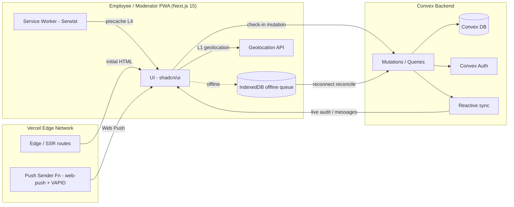
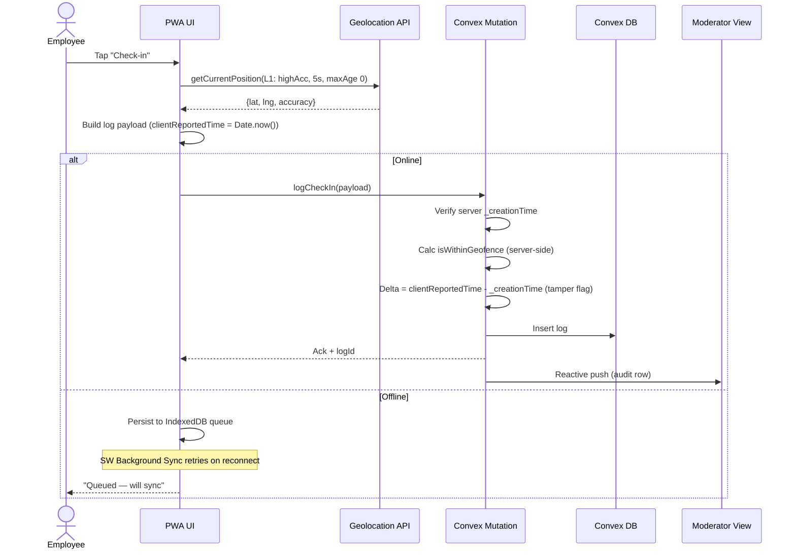

# J-Pay — Technical Requirements Document (TRD)

**Project:** J-Pay (Payroll & Geolocation Logger PWA)
**Repository:** `TeacherEvan/J-pay-webb_logger`
**Status:** Draft v0.2 (corrected)
**Author:** Architecture pass — reviewed against hard system limits and stack constraints.

---

> **Reviewer's Note (applied to this revision):** The originating prompt contained five structural gaps that would have produced a TRD with silent holes. This document closes them:
> 1. PWA install can **not** auto-fire on link access — it requires a captured `beforeinstallprompt` event triggered by a **user gesture**.
> 2. The data path Employee → Convex is **direct**; Vercel's 10s/4.5MB limits only bound SSR/Edge routes, not the check-in mutation.
> 3. **Convex is not a Web Push provider** — push needs VAPID + a sender (a Vercel Function running `web-push`, or an external provider).
> 4. **No auth provider** was declared; Moderator "backend-provisioned only" access presumes one. Convex Auth (or Clerk) is required.
> 5. **Offline check-in queue** was mandated by the limits but unspecified — IndexedDB + Background Sync / reconnect reconciliation is now designed.

---

## 1. Overview & Goals

J-Pay is a Progressive Web App for field-workforce payroll and geolocation logging. Employees (mobile) log time-and-place events; Moderators (desktop) audit locations, manage geofences, and compute payroll.

Non-goals: live turn-by-turn navigation, biometric facial verification, native app stores (PWA-only by design).

## 2. Stack Requirements (binding)

| Layer | Technology |
|-------|------------|
| Frontend | Next.js 15 (App Router), TypeScript, Tailwind CSS, shadcn/ui |
| Backend/DB | Convex (reactive DB, auth, file storage, real-time sync) |
| Deployment | Vercel (Edge network) |
| PWA | Serwist (`@serwist/next`) for service worker + manifest caching |
| Auth | **Convex Auth** (added — see §4.4) |
| Push | **Web Push API + VAPID** via a Vercel Function (added — see §4.5) |

> **Why Serwist over next-pwa:** `next-pwa` is unmaintained for Next 15's App Router; Serwist is the actively-supported successor with first-class App Router support.

## 3. Hard Technical Limits (must be enforced in code)

| # | Limit | Enforcement point |
|---|-------|-------------------|
| L1 | `navigator.geolocation` → `enableHighAccuracy:true`, `timeout:5000`, `maximumAge:0` | Client check-in wrapper (non-overridable constant) |
| L2 | Convex document/argument size ≤ **1 MB** (this is the document/argument cap, not a "transaction" cap) | Log payload schema; reject attachments > 1MB |
| L3 | Vercel Serverless/Edge execution ≤ **10 s**; response body ≤ **4.5 MB** | Only SSR/API routes; see §3.1 |
| L4 | Service-worker precache budget < **50 MB** for core assets | Build-time asset audit in CI |

### 3.1 Path-clarity on L3
The Employee check-in flow is **Client → Convex** (WebSocket/mutation), which is **not** subject to Vercel's 10s/4.5MB function limits. L3 applies **only** to:
- Next.js Server Components / Route Handlers (SSR, initial HTML).
- The Push-sending Vercel Function (§4.5).
- CSV export streaming (§6.6) — must paginate to stay under 4.5MB per response.

## 4. Architecture

### 4.1 System Architecture (Mermaid)

### 4.2 Database ERD (Mermaid)

```mermaid
erDiagram
  USERS ||--o{ LOGS : "records"
  USERS ||--o{ MESSAGES_SENT : "sends"
  USERS ||--o{ MESSAGES_RECV : "receives"

  USERS {
    id string PK
    name string
    email string
    role enum "moderator|employee"
    isActive boolean
    deviceId string "optional, device binding"
    hourlyRate number "mod-editable"
    allowedGeofenceRadiusMeters number "mod-editable"
    designatedLocationLat number "optional"
    designatedLocationLng number "optional"
    archivedAt number "soft delete"
    pushSubscriptionTokens string[] "optional"
  }
  LOGS {
    id string PK
    userId id FK
    _creationTime number "SERVER UTC, trusted"
    clientReportedTime number "tamper-delta check"
    status enum
    latitude number
    longitude number
    accuracyMeters number
    isWithinGeofence boolean "server-calc"
    sideMissionDurationMinutes enum "15|30|45|60|120"
    deviceMetadata string
    ipAddress string "optional, from headers"
  }
  MESSAGES {
    id string PK
    senderId id FK
    recipientId id "optional = mod queue"
    content string
    isRead boolean
    archivedAt number "soft delete"
  }
```

### 4.3 Geolocation Check-in Sequence (Mermaid)

### 4.4 Authentication (added — gap closed)
- **Convex Auth** with password (or magic-link) provider; Moderator accounts are **seeded/created only by an existing Moderator** (backend-provisioned, never self-signup).
- Employee accounts: created by Moderator, issued a one-time activation link; on first login the `deviceId` is bound (see §4.7).
- Role enforced server-side on every Moderator query/mutation via `ctx.auth` + a `requireModerator` wrapper.

### 4.5 Push Notifications (added — gap closed)
Convex does **not** send Web Push. Architecture:
1. Employee subscribes via `pushManager.subscribe` using a **VAPID public key** shipped in the manifest/env.
2. Subscription endpoint + key stored in `users.pushSubscriptionTokens`.
3. A **Vercel Function** (`/api/push`) holds the VAPID private key (env secret) and calls `web-push` to dispatch reminders/approvals.
4. Triggers: scheduled reminders via Convex cron → enqueue → Vercel Function sends. Approval alerts fired from the Moderator payroll-approve mutation via an action that calls the Function.

> **Hardening:** VAPID private key is a Vercel env secret, never in client bundle.

### 4.6 Offline Support (added — gap closed, mandated by L4)
- **Precache** (L4 < 50MB): app shell, critical JS/CSS, logo assets, locale data.
- **Runtime cache:** network-first for API, cache-first for static.
- **Offline check-in queue:** on `getCurrentPosition` success but no connectivity, write the log to **IndexedDB** with `synced:false`. A Serwist **Background Sync** handler flushes the queue when connectivity returns; the same mutation path (§4.3) reconciles, and server `_creationTime` remains the trusted timestamp (client time used only for delta/tamper analytics).
- **Conflict rule:** last-write-wins per `logId`; duplicates detected by `(userId, clientReportedTime, status)` hash.

### 4.7 Device Binding & Recovery (added — gap closed)
- `deviceId` pins an employee to one physical device.
- **Recovery flow:** employee requests re-binding from a *different* device → Moderator verifies identity out-of-band → `unbindDevice` mutation clears `deviceId` → new device binds on next login.
- Lockout: check-ins from an unbound device for a bound user are rejected server-side with code `DEVICE_MISMATCH`.

## 5. Feature Specifications

### 5.1 Application Initialization
- On first load, the SW registers; capture `beforeinstallprompt` (**cannot auto-show**). Show a custom "Install J-Pay" button that calls `prompt()` on the captured event (user gesture requirement).
- Loading screen: animated J-Pay SVG/CSS logo reveal (pure CSS, < 200KB, counts toward L4).
- Consent modal (geolocation + localStorage) — copy: **"All work, no ads!"**; blocks app until accepted (stored as a consent flag, revocable in settings).

### 5.2 Employee Interface (mobile-first)
- Single prominent **Check-in** button → records GPS, accuracy radius, UTC timestamp (server-trusted).
- State badges: `checkpoint`, `lunch`, `arrived`, `day finish`, `job finish`, `feeling sick`.
- **Quick side mission** dropdown strictly limited to `[15m, 30m, 45m, 1h, 2h]` (mapped to Convex enum `15|30|45|60|120`).
- Direct messaging: one-way employee → Moderator queue.
- Push: logging reminders + approval alerts (§4.5).

### 5.3 Moderator Interface (desktop-optimized)
- Access only via Moderator role (§4.4).
- Real-time audit log of employee locations (Convex reactive query).
- Payroll calculator — editable: hourly rates, multipliers, **overtime threshold (default 8h/day or 40h/wk), currency (ZAR default), rounding rule (nearest 5 min)**.
- Diagram drafting: lightweight `<canvas>` whiteboard **or** Mermaid live-editor embed.
- Constraint management: geofence radius, allowed login IP ranges (CIDR list enforced on mutation).
- Two-way messaging: Mod→Mod broadcast, Mod→Employee direct (Convex reactive).
- Reporting: CSV export of date ranges (§6.6).

## 6. Data & Compliance

### 6.1 Geofence Default (gap closed)
If `designatedLocationLat/Lng` is unset at activation, the Moderator **must** set it before the employee can log; server rejects `isWithinGeofence` calc with `GEOFENCE_UNSET` otherwise. Default `allowedGeofenceRadiusMeters = 100` if Moderator omits.

### 6.2 Time Zones (gap closed)
All stored timestamps are **UTC** (`_creationTime`). Payroll/reporting converts to the **employee's configured timezone** (field `timezone` on users, default `Africa/Johannesburg`). Reports never display raw UTC to Moderators.

### 6.3 Privacy / PII / Retention (gap closed)
Geolocation is sensitive personal data.
- **Lawful basis & retention:** define in a privacy notice; default retention **13 months** then anonymize (`archivedAt` soft-delete + geohash truncation job).
- **POPIA (ZA) / GDPR (EU)** compliance notes required in the deployed privacy page.
- IP ranges and precise coords are Moderator-only; employees see only their own logs.

### 6.4 Payroll Rules (gap closed)
- Multipliers: ordinary (1.0), overtime (1.5), Sunday/holiday (2.0) — Moderator-editable per employee.
- Rounding: configurable, default round-to-nearest-5-min.
- Currency: single tenant currency (ZAR default), no FX conversion in v1.
- Approval: Moderator "approves" a pay period → locks edits → triggers payout-export (CSV/JSON).

### 6.5 CSV Export at Scale (gap closed)
Large date ranges can exceed L3's 4.5MB. Export is **streamed/paginated**: the Vercel Function writes the CSV in chunks and returns a download token; the client fetches paginated blobs and assembles, or Convex Action streams to object storage and returns a signed URL.

### 6.6 Error / Retry / Observability (gap closed)
- Geolocation failure (timeout/denied): UI offers manual "retry" + reason code; never silently drops.
- Mutation retry: Convex client auto-retries transient failures; offline queue handled by §4.6.
- Observability: Convex dashboard + Vercel logs; client error boundary reports to a `/api/log` route (non-blocking).

## 7. Build / CI (gap closed)
- Lint + typecheck + `tsc --noEmit` gate.
- **L4 asset audit:** CI script sums precache asset sizes; fails build if ≥ 50MB.
- Deploy preview per PR; production deploy on `main` via Vercel.

## 8. Open Questions for Product Owner
1. Multi-tenant or single-org? (Affects schema isolation.)
2. Payroll payout integration (bank API) in scope for v1?
3. Device-binding recovery: out-of-band verification method (SMS/email)?
4. Diagram tool: canvas freehand vs Mermaid embed — which?

---
*Generated as the corrected deliverable. Web-based citation was unavailable at authoring time (search backend billing block); platform constraints stated are established framework behaviors. Validate against current Next 15 / Convex / Serwist docs at implementation.*
