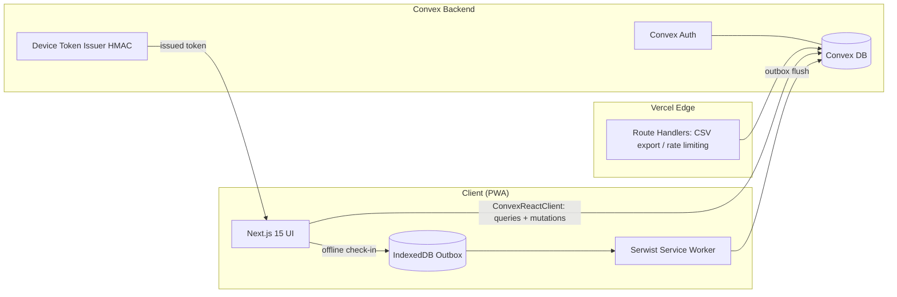
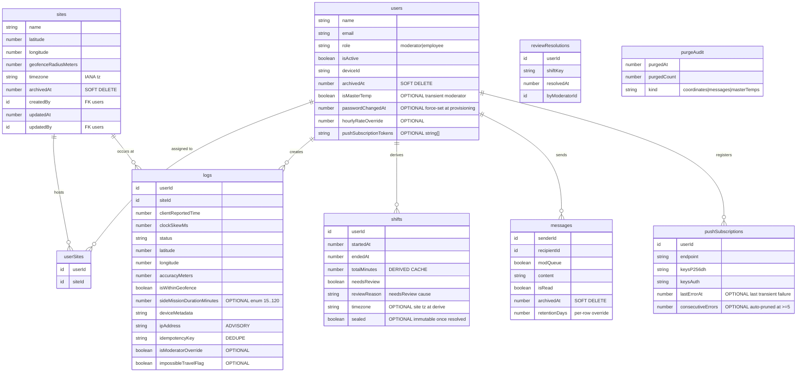
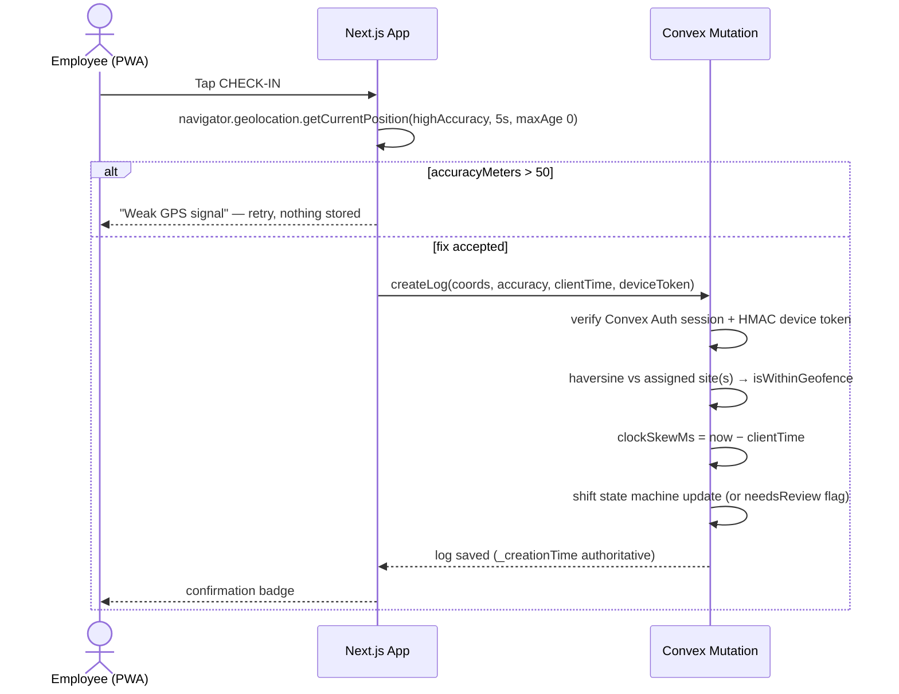
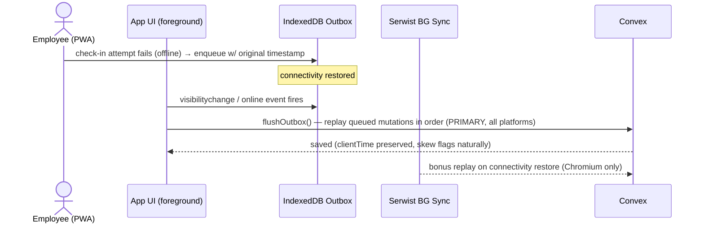
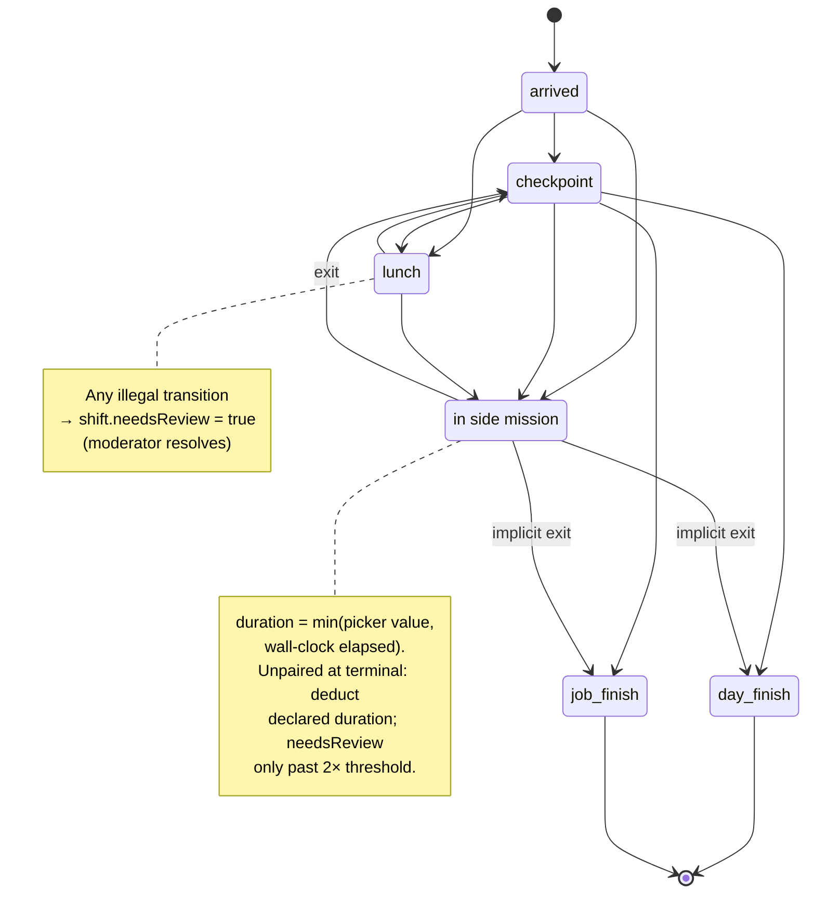

# J-Pay — Technical Requirements Document (TRD)

**Project:** PWA Payroll & Geolocation Logger
**Repository:** This workspace (`J-pay`) — one fork per client per ADR-002
**Version:** 1.3.0 (Next 16.3.2 + Serwist 10-preview upgrade — D2 closed)
**Status:** Implemented — working preview (see docs/notes/)

### Revision Log (v1.1 → v1.2)

| # | Section | Change |
|---|---|---|
| R1 | §5.1/§6 | Side mission defined as substate; grammar extended (was illegal transition → needsReview flood) |
| R2 | §5.1 | Weak-GPS moderator override path added |
| R3 | §5.3 | Device token cloneability documented; issuance preconditions + WebAuthn upgrade path |
| R4 | §7 | Row-scoped authz hard rule (`ctx.auth` only, never client-supplied userId) |
| R5 | §6 | Schema: `logs.idempotencyKey`, `logs.siteTimezone`, `logs.impossibleTravelFlag`, `sites.timezone` |
| R6 | §6.1 | Shift grammar: skew-corrected sort, idempotency dedupe, 16h auto-close, overnight/DST rules |
| R7 | §8 | Offline replay ordering rule |
| R8 | §7 | Impossible-travel heuristic (>200 km/h between fixes) |
| R9 | §9 | Retention enforced by Vercel Cron → Convex purge mutation |
| R10 | §5.2 | CSV formula-injection sanitization + pagination vs 4.5MB cap |
| R11 | §7 | clockSkewMs stored at write → indexable |
| R12 | §5.2 | Push subscription pruning on 404/410 |
| R13 | §4 | Consent modal links privacy notice |
| R14 | §11 | Open Questions updated |
| R15 | §7/§3 | Impossible-travel previous-fix lookup specified (`by_user_time` desc, ≤5-entry scan); skew filter honest two-tail `by_user_skew` query |
| R16 | §3/§8 | Limits corrected to live-verified values (Convex 1 MiB doc / 16 MiB tx budget; Vercel Fluid compute 300s/800s, 4.5MB cap) |
| R17 | §8/§5.1 | Offline replay foreground-primary (`visibilitychange`/`online`); Background Sync demoted to Chromium-only bonus with platform-support table |
| R18 | §9 | Purge = anonymize-on-purge (zero out lat/lng, row retained); enforced by native Convex cron (`convex/crons.ts`) writing purge-audit rows |
| R19 | §6 | `sites` audit fields added (`createdBy`, `updatedAt`, `updatedBy`); ERD synced |
| R20 | §5.2 | Push sender named: `web-push` (v3.6.7) via Convex Action; VAPID key single surface in Convex env |
| R21 | §10 | Diagrams refreshed: client-direct topology (§10.1), `flushOutbox()` primary replay lane (§10.4), side-mission substate (§10.5) |
| R22 | Global | Legacy third-party auth vendor removed (see REVIEW-v1.1) → Convex Auth (password provider) per owner decision 2026-08-23; device-token issuance inside Convex (single HMAC secret surface) |
| R23 | §10.2 | ERD synced to §6 schema: 11 missing attributes restored across logs/shifts/users/messages/sites; mechanical ERD-sync gate added to `check_consistency.py` |
| R24 | §5.2/§11 | Payroll "multipliers" over-promise aligned to schema (`hourlyRateOverride` only); payroll-config gap logged as Open Question 8 per §1.1 conflict rule |
| R25 | §9/§6 | `messages.retentionDays` wired into retention policy text (was schema-orphaned) |
| R26 | §10.5 | side-mission → `day_finish` implicit-exit edge added (matches §6.1 rule 8); gate-enforced |
| R27 | Scripts | Gates hardened: ERD-sync, README-version, day_finish-edge, retentionDays-wiring checks; document paths resolved from script location (portable across checkouts) |
| R28 | Global | Implementation landed in THIS workspace per owner directive 2026-08-24 (supersedes the historical `J-pay-webb_logger` target): Next.js 15 + Convex backend implementing §6 verbatim, moderator console, offline outbox, payroll, messaging, push scaffolding. See README + docs/notes/. |
| R29 | §1/§11 context | Fork-per-client model adopted (ADR-002) resolving multi-tenancy D1; shift grammar extracted to pure module with 15-case unit suite (ADR-003); `npm test` added to repo gates |
| R31 | §6/§7 | Schema amendments (additive): `logs.by_user_idem` index for unbounded idempotency dedupe; `reviewResolutions` table so moderator Resolve survives re-derivation (was silently reset by next check-in). Unguarded moderator queries closed; device-token HMAC refuses missing secret; site/provisioning input validation added |
| R32 | §5.2 | One-time forced password change: `users.passwordChangedAt` (undefined = must change); non-dismissable modal on first sign-in for both roles |
| R33 | §7 | Key-gated break-glass ops: `provisionModerator`, `resetPasswordBreakGlass`, `archiveUserBreakGlass` (BOOTSTRAP_KEY); placeholder owner archived |
| R34 | §10.1 | Live-auth loop fixed: CORS on `/.well-known/*` (+OPTIONS); anonymous-tolerant queries end UNAUTHENTICATED crashes; dead sessions auto-sign-out |
| R35 | §6/§5.2/§9 | Investor/fork hardening: `shifts.timezone`+`sealed`, `by_started`/`by_active` indexes; bounded re-derivation (sealed rows immutable, writes windowed); per-site tz day bucketing; pluggable payroll strategies (`src/lib/payroll-strategies.ts`: flat/BCEA/dailyOT, BCEA default 1.5× >45h/wk + 2× Sunday — ⚠ UNVERIFIED citation pending); `src/config/jpay.config.ts` pure-constant contract (engine/logs/crons wired); KPI banner (`convex/kpi.ts`), geofence modal (Leaflet reuse), `/~offline` fallback precached; `DEMO_MODE=1`-gated idempotent demo seeder through real pipeline (`convex/demo*.ts`) |
| R36 | §5.1/§7 | Demo preview is opt-in at login, not ambient: when `DEMO_MODE=1`, an Anonymous Convex Auth provider is registered and the sign-in screen renders "Enter demo preview" (gated server-side via public `demo.status` query). Anonymous sessions become throwaway `isAnonymous: true` employees auto-assigned to every active site (the 3 demo sites are self-created if none exist); forced password change skipped via `passwordChangedAt`. Daily cron purges reviewers older than 7 days with all dependent rows (logs/shifts/userSites/pushSubscriptions/messages/reviewResolutions). Sign out button added to app header (was absent entirely). Password sign-in path unchanged |
| R30 | §5.3 enforcement | Device-token lifecycle aligned to contract: self-serve issuance only when no device bound; re-issue requires moderator reset (`resetDeviceToken`). §11 Q9 opened for `feeling sick` semantics. Build-time postcss/sharp advisories accepted until Next 16 decision (D2) — CI gates added (`.github/workflows/gates.yml`) |
| R37 | §2/§3/§11 | **Next 16.3.2 upgrade (closes D2).** `next` bumped 15.3 → 16.3.2 clearing the postcss 4 + sharp 4 high-severity advisories that were transitively bundled. `@serwist/next` bumped 9.5.12 → 10.0.0-preview.14 (Next 16 compat; export paths unchanged so `src/app/sw.ts` did not need a code change). `glob` pinned to `^11.1.0` via `overrides` to clear the Serwist-10 transitive GHSA-5j98-mcp5-4vw2 (CLI command injection in a build-time-only tool — not exploitable from this codebase, tracked as Open Question #10). Production build stays on **webpack** (`next build --webpack`) because Serwist 10-preview does not yet support Turbopack SW generation (https://github.com/serwist/serwist/issues/54); Turbopack adoption deferred to Open Question #11. New canary workflow at `.github/workflows/canary.yml` deploys to a Vercel preview on PRs labeled `next16-canary`. Rollback runbook at `docs/ops/next-16-rollback.md`. See `docs/plans/2026-08-25-next-16-upgrade.md` for the full plan + audit before/after snapshots. |
| R38 | §6/§10.2/§11 | **Per-feature review fixes + master password + dashboard (owner 2026-08-26).** B1: `changeMyPassword` rewired from raw `auth:store` to high-level `retrieveAccount()` (the previous call omitted the required `{ args: ... }` wrapper so every attempt died with `ArgumentValidationError`). H1: `kpi.summary` now requires moderator auth. H2: `useUserLocale` skips query when unauthenticated. H3: `replyToEmployee` validates recipient is an active employee. H4: push subscription error tracking (auto-prune at ≥5 consecutive failures). H5: `deactivateEmployee` now also sets `isActive: false`. H6: daily message retention purge cron (`messages.retentionDays`). H7: `purgeAudit` table + audit rows for coord/message/temp sweeps. H8: Nominatim geocoding routed through server-side Convex action with proper `User-Agent`. H9: consent dialog surfaces privacy policy link. H11/H12: 44px min-height on all interactive touch targets. Schema: `users.isMasterTemp`, `pushSubscriptions.lastErrorAt/consecutiveErrors`, new `purgeAudit` table, `messages.by_sender` index. Master-password feature: `ConvexCredentials` provider (`id: "master"`) checks `MASTER_PASSWORD` env var; creates temporary moderator on login, archiving on sign-out + daily cron sweep. New `/dashboard` route for moderators (KPIs + audit log + employee roster). Demo fix B2: `ensurePersonaSiteAssignments` called on bind so Thabo has site rows; `boundPersonaSites` query replaces hardcoded `sites.listMine` in demo CheckInPanel. Broadcast filtered to exclude demo users. TRD §6 + §10.2 + §11 updated. |

---

## 1. Overview

J-Pay is a Progressive Web App for field-employee time tracking and payroll. Employees check in/out with GPS-verified timestamps; moderators audit locations in real time, manage constraints, compute payroll over derived shifts, and export CSV reports. Built mobile-first for employees, desktop-optimized for moderators.

### 1.1 Conflict Rule

The embedded schema (§6) is the source of truth. Where feature specifications and schema disagree, the schema wins and the discrepancy is flagged in §11 Open Questions.

---

## 2. Stack Requirements

| Layer | Technology |
|---|---|
| Frontend | Next.js 15 (App Router), TypeScript, Tailwind CSS, shadcn/ui |
| Backend/DB | Convex (reactive database, file storage, real-time sync) |
| Auth | **Convex Auth** (`@convex-dev/auth`, registry-verified v0.0.95 2026-08-11) with password provider; sessions via `ctx.auth`. Roles (`moderator` \| `employee`) stored on the `users` row and enforced server-side. Moderator provisioning = invite-only internal mutation (no self-signup route shipped). |
| Deployment | Vercel (Edge network). Client applications connect **directly to Convex** via `ConvexReactClient` using the public `NEXT_PUBLIC_CONVEX_URL`, authenticated with Convex Auth sessions. Vercel Route Handlers exist only for secret-free server conveniences: CSV export assembly and edge rate-limiting (device-token issuance moves INTO Convex per Task 7/M5). Data isolation comes from row-scoped authz inside every Convex function (§7 R4), never from URL concealment. |
| PWA | Serwist (service worker generation, manifest caching, Background Sync) |

---

## 3. Hard Technical Limits

The architecture is designed around these limits explicitly:

1. **Geolocation:** `navigator.geolocation` with `enableHighAccuracy: true`, `timeout: 5000`, `maximumAge: 0`. Any fix with `accuracyMeters > 50` is **rejected**; UI surfaces a "weak GPS signal" state instead of storing junk data.
2. **Convex document size ≤ 1 MiB per document/nested object; 16 MiB read + 16 MiB written per transaction** (verified docs.convex.dev/production/state/limits, 2026-08-23). Each log is ≪ 1 MiB; outbox replay batches are bounded by the 16 MiB write budget — cap batches at 200 entries for headroom.
3. **Vercel Functions (Fluid compute): duration configurable up to 300s Hobby / 800s Pro; response/request body cap 4.5MB hard** (`413 FUNCTION_PAYLOAD_TOO_LARGE`) (verified vercel.com/docs/functions/limitations, 2026-08-23). Only CSV export assembly approaches these; paginate on `by_user_time`.
4. **Service worker cache:** budget < **50MB** for core app assets, with an LRU eviction strategy on runtime caches.
5. **Web Push:** encrypted message payload ≤ **4KB**. Notifications are trigger-only; clients fetch real content after wake.
6. **IP address is advisory telemetry only.** It must never be documented or implemented as an enforcement control — clients can bypass edge checks and spoof headers. See §7 Security.

---

## 4. Application Initialization

- Capture `beforeinstallprompt`; suppress default; show custom install UI.
  - **iOS reality:** no programmatic install prompt exists. Show manual "Add to Home Screen" instructions when iOS is detected.
- Initial loading screen: animated J-Pay logger SVG/CSS logo reveal.
- Consent modal enforcing geolocation + localstorage permissions. Copy: **"All work, no ads!"**
  - The modal MUST link the full privacy notice (data collected, lawful basis, retention, worker rights per §9). The modal alone is transparency shorthand, not the notice.
  - NOTE: employment-context consent is legally weak (GDPR Art. 7 power imbalance). The data-governance section (§9) cites **legitimate interest** as the lawful basis for location processing, with this modal serving as transparency notice only.

---

## 5. Feature Specifications

### 5.1 Employee Interface (Mobile-First)

- Single prominent **CHECK-IN** button: records GPS coords, accuracy radius, UTC timestamp (server time authoritative), device metadata.
- Quick-add status badges matching `logs.status` exactly:
  `["checkpoint", "lunch", "arrived", "day finish", "job finish", "feeling sick", "quick side mission"]` + side-mission duration picker.
- **Side mission semantics (v1.1):** a side mission is a **substate**, not a standalone event. Tapping it writes a log with status `quick side mission` + duration; the shift engine (§6.1) treats it as entering a substate that must be exited by the next `checkpoint` or `job finish`. Duration is deducted from worked minutes. It is a legal transition from any active state.
- **Weak-GPS override (v1.1):** fixes with `accuracyMeters > 50` are rejected client-side, but a moderator can manually attest a check-in (mod UI: employee + site + time → creates a log with `isModeratorOverride: true`). Without this, basement/indoor sites generate zero records and payroll disputes have no evidence trail.
- One-way messaging to Moderator queue.
- Web Push reminders + approval alerts.
- **Offline mode (foreground-primary):** failed check-ins enqueue to an IndexedDB outbox. Foreground reconciliation — `visibilitychange`, the window `online` event, and the next successful mutation — flushes the outbox on ALL platforms (primary path, see §8); Background Sync is a Chromium-only bonus. Original client timestamps are preserved and flagged through `clientReportedTime` delta.

### 5.2 Moderator Interface (Desktop-Optimized)

- Access provisioned backend-only (invite-only internal Convex mutation sets role; not self-service).
- Real-time audit log of employee locations (Convex reactive queries).
- Payroll calculator over derived **shifts** (§6), editable hourly rates (per-user `users.hourlyRateOverride`). Overtime/site pay multipliers are NOT modeled in schema — tracked as Open Question 8 (flagged per §1.1 conflict rule).
- Lightweight diagram tool (canvas or mermaid render-only).
- Constraint management: geofence radius per site assignment; IP ranges displayed as advisory signals, clearly labeled non-enforcing.
- Two-way messaging: Mod-to-Mod broadcast; Mod-to-Employee direct (Convex reactive queries).
- Reporting: CSV export by employee + date range (uses `by_user_time` index).
  - **Formula-injection sanitization (v1.1):** any cell value beginning with `=`, `+`, `-`, or `@` is prefixed with `'` on export (employee names, message content are attacker-controllable).
  - **Pagination (v1.1):** exports paginate on `by_user_time` and stream chunks; a single response must never approach the 4.5MB Vercel cap.
- **Push subscription maintenance (v1.1):** when a push send returns 404/410, delete the `pushSubscriptions` row. Without pruning, dead endpoints accumulate indefinitely. Push dispatch runs as a **Convex Action** calling the `web-push` npm package (v3.6.7, registry-verified 2026-08-23); VAPID private key lives ONLY in Convex env — no second secret surface.
- **Moderator manual check-in attestation (v1.1):** override flow for weak-GPS sites (see §5.1).

### 5.3 Device Binding

- Server-issued signed device token (HMAC, secret held solely in Convex env), stored in IndexedDB, verified server-side on each mutation.
- **Issuance preconditions (v1.1):** tokens are issued **inside Convex** (internal mutation at activation). Issuance requires a valid Convex Auth session for an invited `role === "employee"` user with `isActive === true`; self-signup route is not shipped (moderator invite-only provisioning). If edge issuance is ever required for rate-limiting, that reintroduces a second secret surface — rejected per review M5 unless documented need arises.
- **Known limitation (v1.1):** an IndexedDB-stored HMAC token proves *possession*, not *device* — any employee can extract their own token via DevTools and share it (buddy punching). Moderators MUST treat duplicate-token usage across distinct devices/IPs as a fraud signal. Optional hardening: WebAuthn platform authenticator (`authenticatorAttachment: "platform"`) for hardware-backed identity on modern Android/iOS; recommended Phase 2.
- Loss of device = moderator-triggered re-issue flow.
- A localStorage copy alone is **NOT** sufficient identity.

---

## 6. Data Model

```ts
import { defineSchema, defineTable } from "convex/server";
import { v } from "convex/values";

export default defineSchema({
  users: defineTable({
    name: v.string(),
    email: v.string(),
    role: v.union(v.literal("moderator"), v.literal("employee")),
    isActive: v.boolean(),
    passwordChangedAt: v.optional(v.number()), // undefined = still using provisioned ID code
    deviceId: v.optional(v.string()),          // signed device token id
    archivedAt: v.optional(v.number()),        // soft delete (payroll compliance)
    isMasterTemp: v.optional(v.boolean()),     // transient moderator via master-password login
    hourlyRateOverride: v.optional(v.number()),
    pushSubscriptionTokens: v.optional(v.array(v.string())),
  })
    .index("email", ["email"])
    .index("by_role", ["role"])
    .index("by_active", ["isActive"]),

  sites: defineTable({
    name: v.string(),
    latitude: v.number(),
    longitude: v.number(),
    geofenceRadiusMeters: v.number(),
    timezone: v.string(),                      // IANA tz — payroll day boundaries are LOCAL (v1.1)
    archivedAt: v.optional(v.number()),
    createdBy: v.id("users"),                  // site provisioning audit (v1.2, M6)
    updatedAt: v.optional(v.number()),
    updatedBy: v.optional(v.id("users")),
  }),

  userSites: defineTable({                     // employees assigned to one+ sites
    userId: v.id("users"),
    siteId: v.id("sites"),
  })
    .index("by_user", ["userId"])
    .index("by_site", ["siteId"]),

  logs: defineTable({
    userId: v.id("users"),
    siteId: v.id("sites"),
    // Server _creationTime is authoritative. clientReportedTime exists to
    // detect clock tampering delta only.
    clientReportedTime: v.number(),
    clockSkewMs: v.optional(v.number()),       // computed at write; mods filter |skew| > 30000
    status: v.union(
      v.literal("arrived"),
      v.literal("checkpoint"),
      v.literal("lunch"),
      v.literal("feeling sick"),
      v.literal("day finish"),
      v.literal("job finish"),
      v.literal("quick side mission")
    ),
    latitude: v.number(),
    longitude: v.number(),
    accuracyMeters: v.number(),                // rejected if > 50 at write time
    isWithinGeofence: v.boolean(),             // haversine computed strictly server-side
    sideMissionDurationMinutes: v.optional(
      v.union(v.literal(15), v.literal(30), v.literal(45), v.literal(60), v.literal(120))
    ),
    deviceMetadata: v.string(),
    ipAddress: v.optional(v.string()),         // ADVISORY ONLY — never enforcement
    idempotencyKey: v.string(),                // client-generated UUID per button press; mutation dedupes (v1.1)
    isModeratorOverride: v.optional(v.boolean()), // manual attestation for weak-GPS sites (v1.1)
    impossibleTravelFlag: v.optional(v.boolean()), // >200 km/h vs previous fix (v1.1)
  })
    .index("by_user_time", ["userId"])  // _creationTime tiebreaker auto-appended
    .index("by_status", ["status"])
    .index("by_site_time", ["siteId"])
    .index("by_user_skew", ["userId", "clockSkewMs"])
    .index("by_user_idem", ["userId", "idempotencyKey"]),

  shifts: defineTable({                        // DERIVED cache; logs are truth
    userId: v.id("users"),
    startedAt: v.number(),
    endedAt: v.optional(v.number()),
    totalMinutes: v.optional(v.number()),
    needsReview: v.boolean(),                  // malformed/out-of-order sequences land here
    reviewReason: v.optional(v.string()),
    timezone: v.optional(v.string()),          // site tz captured at derive time (per-site day bucketing)
    sealed: v.optional(v.boolean()),           // resolved/moderator-finalized rows are immutable to re-derivation
  })
    .index("by_user_start", ["userId", "startedAt"])
    .index("by_started", ["startedAt"])        // weekly KPI aggregation
    .index("by_active", ["endedAt"])           // active-on-site count
    .index("by_needs_review", ["needsReview"]),

  messages: defineTable({
    senderId: v.id("users"),
    recipientId: v.optional(v.id("users")),
    modQueue: v.boolean(),                     // do NOT rely on recipientId absence — not indexable
    content: v.string(),
    isRead: v.boolean(),
    archivedAt: v.optional(v.number()),        // archive ≠ delete; retention per §9
    retentionDays: v.optional(v.number()),
  })
    .index("by_recipient_read", ["recipientId", "isRead"])
    .index("by_modqueue_unread", ["modQueue", "isRead"])
    .index("by_sender", ["senderId"]),           // master-temp archive message lookup

  pushSubscriptions: defineTable({             // one row per subscription → rotation/dedup
    userId: v.id("users"),
    endpoint: v.string(),
    keysP256dh: v.string(),
    keysAuth: v.string(),
    lastErrorAt: v.optional(v.number()),       // last transient push failure (H4)
    consecutiveErrors: v.optional(v.number()), // auto-pruned at ≥5 (H4)
  })
    .index("by_user", ["userId"]),

  reviewResolutions: defineTable({             // moderator "Resolve" survives re-derivation
    userId: v.id("users"),
    shiftKey: v.string(),                      // `${startedAt}` of the flagged segment
    resolvedAt: v.number(),
    byModeratorId: v.id("users"),
  })
    .index("by_user_key", ["userId", "shiftKey"]),

  purgeAudit: defineTable({                   // observable purge run log (H7)
    purgedAt: v.number(),
    purgedCount: v.number(),
    kind: v.union(v.literal("coordinates"), v.literal("messages"), v.literal("masterTemps")),
  })
    .index("by_purged_at", ["purgedAt"]),
});
```

### 6.1 Shift Derivation Grammar (strict)

Legal transitions:

```
(arrived | job finish) → checkpoint? → lunch → checkpoint (resume)
→ ... → day finish | job finish
quick side mission: legal from ANY active state; enters a substate
  exited by the next checkpoint or job finish; picker duration deducted
  from worked minutes
```

Derivation rules (v1.1):

1. **Ordering:** candidate logs are sorted by `clientReportedTime` skew-corrected (`clientReportedTime` when `|clockSkewMs| <= 30000`, else `_creationTime`). NEVER derive order from `_creationTime` alone — offline replay and multi-device use produce out-of-order server arrival.
2. **Dedupe:** `idempotencyKey` duplicates are dropped before state-machine evaluation (double-tap / network retry protection).
3. **Auto-close:** a shift with no terminal event (`day finish`/`job finish`) by `startedAt + MAX_SHIFT_HOURS (16h)` is auto-closed with `needsReview = true`, reason `"auto_closed_no_terminal"`.
4. **Unpaired lunch:** a `lunch` without a resuming `checkpoint` deducts the site's default lunch minutes (configurable, default 60) — not needsReview unless it exceeds 2× default.
5. **Overnight/DST:** shift day attribution uses `sites.timezone`. A shift crossing local midnight belongs to the local day it started in. DST transition days (23h/25h) use wall-clock boundaries via IANA tz math, never naive ±24h.
6. **Side-mission entry:** legal from any active state; entering does not pause the shift clock — deduction happens at exit.
7. **Side-mission duration:** authoritative value is `min(declared picker minutes, wall-clock minutes between entry log and exit log)`.
8. **Implicit exits:** `day finish` / `job finish` implicitly close an open side mission.
9. **Unpaired side mission** (no exit before next shift start): deduct declared duration; flag needsReview only if declared > 2× the picker max for that employee's site default — parallel to rule 4's lunch treatment.

- Out-of-order or malformed sequences **never silently miscount**: they create a shift flagged `needsReview = true` for moderator resolution.
- Every payroll number is reconstructible from `logs` alone. `shifts` is a materialized cache; **logs are truth**.

---

## 7. Security

- **AuthN/AuthZ:** Convex Auth sessions validated via ctx.auth (clients connect direct to Convex — no route-handler proxy hop); role checked in every mutation/query. Moderators provisioned backend-only.
- **Demo preview sessions (R36):** the Anonymous provider is registered **only** when `DEMO_MODE=1` in the Convex environment — forks without that env var are structurally incapable of anonymous sign-in. Demo reviewers are `isAnonymous: true` employees with no credentials; they never gain moderator capability, and a daily cron garbage-collects them after 7 days.
- **Row-scoped authz (v1.1 — HARD RULE):** every query and mutation derives the acting `userId` from `ctx.auth` and filters rows by it. A client-supplied `userId` argument is NEVER trusted as an identity or filter input, including on indexed queries like `by_user_time`. Employees read only their own logs/shifts/messages; one unscoped query is a full payroll-data leak.
- **Device binding:** HMAC-signed token issued inside Convex (issuance preconditions per §5.3), stored IndexedDB, verified per mutation. Re-issue flow is moderator-gated.
- **Impossible-travel heuristic (v1.1):** at write time, compare against the employee's previous fix: if implied speed > 200 km/h, set `impossibleTravelFlag = true` for moderator review. Catches naive GPS spoofing cheaply; advisory flag, not a hard reject.
  *Previous-fix definition:* query `logs.by_user_time` with `.order("desc")`, scan back up to 5 entries, take the one with the greatest skew-corrected `clientReportedTime`. This is approximate under offline replay by design — the flag is advisory evidence for moderators, not ground truth.
- **Clock tamper:** `clockSkewMs` computed AND stored at write. Moderators filter via two-tail range queries on `by_user_skew` (`skew ≤ −30000` OR `skew ≥ 30000`) — Convex index ranges cannot express absolute-value scans, so both tails are queried and unioned. Within a single user's date window a post-query filtered scan is also acceptable at this scale; the index exists so large-window audits don't degrade.
- **IP address:** captured where available (edge headers) but treated strictly as advisory telemetry for fraud review. Not an enforcement control — documented as such everywhere it appears.
- **Geofencing:** haversine distance computed server-side inside mutations against the user's assigned site(s). Client-reported `isWithinGeofence` is never trusted.
- **GPS spoofing reality (v1.1):** coords originate from the client and fake-GPS apps are trivial on Android. Server-side defenses are layered: accuracy gating, impossible-travel flagging, device binding fraud signals, moderator review queue. The system is designed to *detect* spoofing, not prevent it.

---

## 8. Offline Architecture

1. Check-in mutation fails (network down) → payload written to **IndexedDB outbox** with original client timestamp.
2. **Replay triggers (primary):** app foregrounding (`visibilitychange`), the window `online` event, and next successful mutation each flush the outbox. These run on ALL platforms.
3. **Bonus trigger:** Serwist Background Sync fires on connectivity restore **on Chromium browsers only** (caniuse `background-sync`: Safari/iOS/Firefox never supported, any version). Treat it as opportunistic acceleration, never the mechanism.
4. Outbox capped (~100 entries) to respect the 16 MiB per-transaction write budget on replay batches (§3 item 2).
5. **Replay ordering rule (v1.1):** shift derivation MUST order by skew-corrected `clientReportedTime` (§6.1 rule 1), because replayed offline entries arrive with `_creationTime` far later than their work actually occurred — ordering by server time would place them in wrong shifts. Multi-device and post-reinstall scenarios produce the same hazard.
6. **Platform-support table (checked 2026-08-23, caniuse.com/background-sync):** Chrome/Edge/Samsung Internet ≥49 ✅ · Safari desktop+iOS ❌ all versions · Firefox ❌ (except behind flag). ZA field workforce skews Android but iPhone share is material — foreground reconciliation is the load-bearing path.

---

## 9. Data Governance & Privacy

- **Lawful basis:** legitimate interest (employment context consent is invalid under GDPR Art. 7 due to power imbalance). Consent modal = transparency notice.
- **Retention schedule (defaults, exact durations = Open Question):**
  - Raw GPS coordinates: **anonymized, not deleted** — purge jobs **zero out lat/lng** and retain the row (status/timestamps/geofence result survive as payroll-dispute evidence); payroll-finalized periods hold anonymization until the dispute window (default 90 days) closes. Exact N days remains Open Question 1.
  - Aggregated hours / shift totals: retained per local labor statute (typically 2–7 years).
  - Messages: archived rows honor an optional per-row `messages.retentionDays` override; absent it, message retention defaults follow Open Questions 1–2.
- **Retention enforcement mechanism (v1.2):** retention is executed, not aspirational — a **native Convex cron** (`convex/crons.ts` → internal purge mutation) runs daily, zeroes raw coords past the retention window, and writes a purge-audit entry. Policy text without a scheduled job is an audit finding.
- **Worker rights:** access/export request procedure defined (self-serve CSV of own logs; includes their push subscription endpoints — these are personal data under Art. 4(1)).
- **Minimization:** no third-party ad/analytics trackers; location recorded only at explicit badge events, never continuous tracking.

---

## 10. Diagrams

### 10.1 System Architecture



### 10.2 Database ERD



### 10.3 Sequence — Geolocation Check-in (happy path)



### 10.4 Sequence — Offline Replay Path



### 10.5 State Diagram — Shift Status Transitions



---

## 11. Open Questions

> Multi-tenancy (former decision D1): **RESOLVED** — one fork per client, single org per deployment (ADR-002).

1. Exact raw-coordinate retention duration (days) after payroll finalization — depends on jurisdiction. **Blocked on jurisdiction research.**
2. Applicable labor-record retention statute(s) for aggregated hours. **Blocked on jurisdiction research.**
3. Multi-site assignment policy: can one employee be geofence-active at multiple sites simultaneously? If yes, `shifts` needs a `siteId` array or per-site split shifts.
4. Side-mission handling within shift math: RESOLVED in v1.1 default (deducted from worked minutes via substate exit pairing) — confirm with payroll stakeholder.
5. Push notification cadence/quiet-hours policy for logging reminders.
6. Site default lunch minutes (v1.1 §6.1 rule 4): confirm 60min default and 2× review threshold per site.
7. WebAuthn platform authenticator rollout timing (v1.1 §5.3 Phase 2): which devices in the field support it?
9. `feeling sick` transition semantics (v1.2.1 implementation note): the grammar (§6.1, §10.5) defines no transitions for this status; current engine treats it as a soft terminal that closes the shift without review. Confirm intended behavior with stakeholders — terminal vs. pausable state.
8. Payroll multiplier modeling: **RESOLVED-DEFAULT (R35)** — pluggable strategy module (`src/lib/payroll-strategies.ts`), BCEA default (1.5× beyond 45h/week; 2.0× Sundays, Sundays excluded from weekly OT accumulation), switchable via `PAYROLL_STRATEGY` env or `jpayConfig.payrollRules.strategy`. Multiplier figures ⚠ UNVERIFIED against BCEA source text — verify before first client fork.
10. **glob@11.0.3 transitive via @serwist/build** (build-time CLI only — not in the runtime tree). Pinned to `^11.1.0` via `overrides` in R37. Re-check on every `npm install` of new Serwist versions; if a future Serwist drops `glob` from its dep tree the override is no-op and can be removed.
11. **Turbopack adoption for production builds** (deferred from R37). Serwist 10 stable + Turbopack support will let us drop the `next build --webpack` flag and the `outputFileTracingRoot` workaround. Track https://github.com/serwist/serwist/issues/54. Until then, `next dev` runs Turbopack (with a Serwist warning) and `next build` runs webpack (clean). If a stable Serwist 10 ships with Turbopack support, plan a D3 upgrade.
12. **Master-password security posture** (R38). The `MASTER_PASSWORD` env var is a single shared secret that opens temporary moderator sessions for any email. Currently stored only in Convex env — rotates per-deployment. Consider adding: per-user rate limiting on master login, audit logging of master sessions, optional IP allowlist, or a short-lived token exchange instead of a static password. For production deployments, the master password MUST be rotated per-client and shared only with authorized moderators.

13. **Schema drift: `punches` table** (convex/schema.ts:49–58) exists in implementation but is absent from TRD §6. This table supports a separate "punch-clock" UI (`/punch` route) with simple in/out semantics (TRD §5.1 only specifies the richer CHECK-IN badge flow). The `punches` feature is a simpler alternative; decision needed on whether to keep both, merge, or remove.

14. **Schema drift: `demoSessions` table** (convex/schema.ts:151–159) and `logs.createdByDemoReviewerId` (schema.ts:93) exist for demo/persona preview mode. These are NOT in TRD §6. They are guarded by `DEMO_MODE=1` env var and gated by `requireDemoReviewer` (access.ts:41–63). Decision needed: document as demo-only in TRD, or remove from production schema.

15. **Schema drift: `users` table fields** — TRD §6 lists mandatory `name: v.string()`, `email: v.string()` but actual schema (via `...authTables` spread from `@convex-dev/auth`) makes them optional and adds `emailVerificationTime`, `image`, `isAnonymous`, plus app-specific `payStrategy`, `locale`. The `authTables` spread is required by Convex Auth; this is a framework constraint. TRD should be updated to reflect the actual generated schema.

---

*End of document.*
